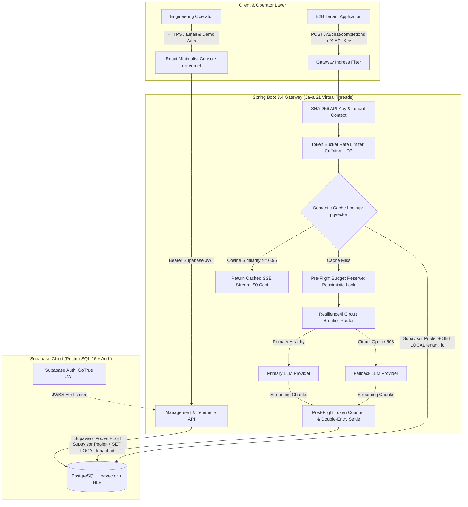
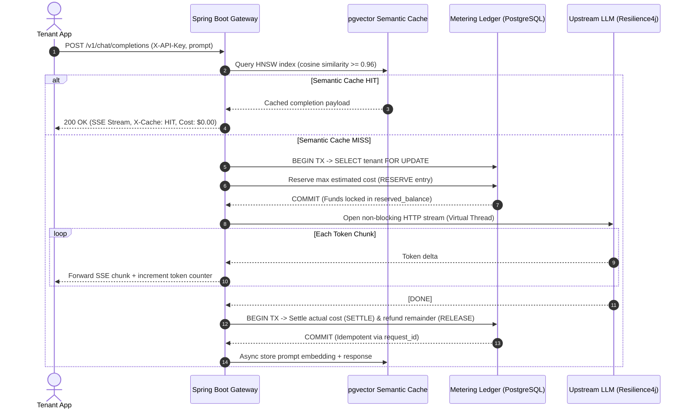
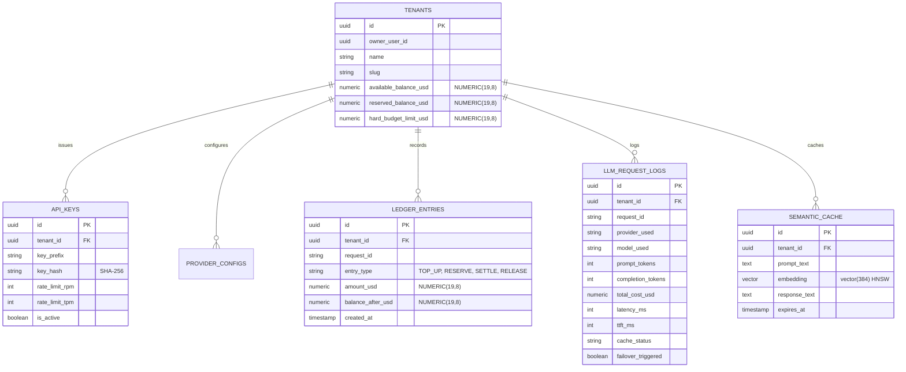

# System Design: AetherGate — Multi-Tenant AI Gateway & Token Metering Engine

## 1. Executive Summary
**AetherGate** is a multi-tenant AI Gateway, semantic caching layer, and deterministic token metering engine built with **Java 21 (Spring Boot 3.4)**, **Supabase PostgreSQL (`pgvector` + Row-Level Security)**, and **React**. It sits as a unified control plane between B2B SaaS applications and upstream LLM providers (OpenAI, Anthropic, Gemini), solving four critical production bottlenecks:
1. **Uncontrolled LLM Spend & Race Conditions:** Prevents concurrent requests from exceeding tenant budgets using two-phase *Pre-Flight Reserve / Post-Flight Settle* accounting.
2. **Redundant Inference Latency & Cost:** Cuts repeat query latency from ~1,200ms to <20ms using `pgvector` HNSW cosine similarity caching.
3. **Upstream Provider Outages:** Automatically fails over across LLM providers using **Resilience4j** Circuit Breakers without dropping client connections.
4. **Strict Multi-Tenant Isolation:** Enforces tenant data boundaries at the PostgreSQL kernel level via **Row-Level Security (RLS)** paired with Java 21 `ScopedValue` context propagation.

---

## 2. High-Level System Architecture

---

## 3. Core Sequence Flows

### 3.1. Two-Phase Token Metering & Streaming Flow
Because LLM streaming responses emit tokens incrementally, the exact completion cost is unknown until the stream terminates. AetherGate uses a **Reserve-Stream-Settle** protocol inspired by payment authorization holds:

---

## 4. Database Schema & Multi-Tenant Isolation

### 4.1. Entity-Relationship Model

### 4.2. Defense-in-Depth Security Controls
1. **Row-Level Security (RLS):** Every tenant-scoped table enforces `tenant_id = NULLIF(current_setting('app.current_tenant_id', true), '')::uuid`. Even if an application-layer query omits a tenant predicate, PostgreSQL prevents cross-tenant reads or writes.
2. **Append-Only Ledger Immutability:** A database trigger (`BEFORE UPDATE OR DELETE ON ledger_entries`) blocks any modification or deletion of historical financial records.
3. **Zero-Trust API Key Storage:** Raw API keys (`ag_live_...`) are displayed once upon generation and stored solely as salted SHA-256 hashes.

---

## 5. Architecture Decision Records (ADRs)

### ADR-001: Java 21 Virtual Threads over Reactive WebFlux
- **Decision:** Use Spring Boot 3.4 on Java 21 with `spring.threads.virtual.enabled=true` instead of Project Reactor / WebFlux.
- **Rationale:** LLM gateway workloads are heavily I/O-bound (waiting hundreds of milliseconds to seconds for upstream token streams). Virtual Threads provide high concurrency (~10,000+ concurrent streams on minimal RAM) while preserving straightforward imperative code, readable stack traces, and clean JPA transaction boundaries.

### ADR-002: `NUMERIC(19, 8)` Fixed-Point Arithmetic for Micro-Cent Metering
- **Decision:** Represent all USD balances and per-token costs as `NUMERIC(19, 8)` in PostgreSQL and `java.math.BigDecimal` in Java.
- **Rationale:** Individual LLM tokens cost fractions of a cent (e.g., `$0.00000015` per token). Floating-point types (`double`/`float`) introduce cumulative rounding drift over millions of requests. Fixed 8-decimal precision guarantees exact reconciliation between `RESERVE`, `SETTLE`, and `RELEASE` entries.

### ADR-003: Dual-Layer Rate Limiting (Caffeine + PostgreSQL Bucket Sync)
- **Decision:** Enforce RPM (Requests Per Minute) and TPM (Tokens Per Minute) limits using an in-memory **Caffeine** Token Bucket backed by PostgreSQL minute-window counters.
- **Rationale:** Eliminates the operational overhead and cost of hosting a dedicated Redis cluster on free-tier infrastructure while still blocking abusive traffic bursts in sub-millisecond memory lookups.

### ADR-004: Supabase Auth + Spring Security OAuth2 Resource Server
- **Decision:** Delegate user identity, password hashing, and session management to Supabase Auth, while Spring Boot validates incoming Bearer JWTs via Supabase's JWKS endpoint.
- **Rationale:** Decouples user authentication from core gateway routing, enabling seamless login on the Vercel React frontend while keeping the Spring Boot backend completely stateless.
### ADR-005: `SET LOCAL ROLE` to make RLS real on Supabase
- **Decision:** Every tenant-scoped transaction runs `set_config('app.current_tenant_id', …, true)` **and** switches to a dedicated `aethergate_app` role (`NOLOGIN NOBYPASSRLS`) via `set_config('role', …, true)`, in one round trip. Tables additionally use `FORCE ROW LEVEL SECURITY`.
- **Rationale:** Supabase's `postgres` role has `BYPASSRLS` (and test containers run as superuser), so policies alone would silently not apply. Both settings are transaction-local, so pooled connections return clean. Pre-tenant lookups (API key hash → tenant, JWT `sub` → tenant) are the only owner-level queries and live in one class (`TenantDirectoryService`).

### ADR-006: Circuit breakers keyed per (tenant, provider)
- **Decision:** Resilience4j breakers are named `tenantId:PROVIDER`; failover is allowed only before the first token is forwarded.
- **Rationale:** In a shared demo, one visitor's chaos experiment must not open the breaker for every tenant. A production deployment that wants shared upstream health would key by provider endpoint. Failing over after tokens were streamed would corrupt the client's stream, so a mid-stream failure ends the request and bills only delivered tokens.

### ADR-007: Hold priced at the most expensive provider in the chain
- **Decision:** `RESERVE = max over enabled providers of cost(prompt_tokens, max_tokens)`, rounded *up*; `SETTLE` rounds half-up and is capped at the hold.
- **Rationale:** Guarantees `actual ≤ reserved` even when a request fails over to a pricier model, so a settlement can never overdraw the balance. A `CHECK (available_balance_usd >= 0)` constraint is the last line of defence.

### ADR-008: Deterministic offline embeddings + built-in LLM simulator
- **Decision:** 384-dim feature-hashing embeddings (word unigrams/bigrams + char trigrams, FNV-1a, sub-linear TF, L2-normalised) computed in Java; providers without an API key are served by a deterministic streaming simulator.
- **Rationale:** The whole platform — cache hits, failover, metering — works end-to-end for an evaluator at $0 and with zero external calls. Real OpenAI / Anthropic / Gemini keys switch the respective provider to its live streaming client without code changes.

### ADR-009: Money as decimal strings on the wire
- **Decision:** `BigDecimal` is serialised with `toPlainString()` as a JSON **string**; the React console formats it by string manipulation.
- **Rationale:** JavaScript numbers are binary doubles; `0.00142000` must survive the round trip to the screen unchanged.

---

## 6. As built

| Area | Implementation |
|---|---|
| Gateway | `POST /v1/chat/completions` (OpenAI-compatible, SSE or JSON), `GET /v1/models`; auth by `X-API-Key` or `Authorization: Bearer ag_live_…` |
| Console API | `/api/v1/me`, `/dashboard/overview?range=24h\|7d\|30d`, `/dashboard/ledger`, `/tenant/api-keys`, `/tenant/providers`, `/tenant/top-up`, `/playground/completions`, `/auth/demo-session` |
| Errors | RFC 7807 `application/problem+json` with stable `type` URIs (`insufficient-quota` 402, `budget-limit-exceeded` 402, `rate-limited` 429 + `Retry-After`, `providers-unavailable` 503, `upstream-interrupted` 502) |
| Database | Schema `aethergate` (shares a Supabase project safely, not exposed via PostgREST), Flyway V1–V3, HNSW index, append-only trigger, RLS USING + WITH CHECK on all tenant tables |
| Demo login | Server-side Supabase password grant; self-healing (resets the demo user via the GoTrue admin API if someone changed its password) |

## 7. Quality gates

| Gate | Result |
|---|---|
| JUnit 5 + AssertJ + Mockito | 98 tests (unit, Testcontainers `pgvector/pgvector:pg17` integration, MockMvc API, ArchUnit) |
| JaCoCo (enforced in `mvn verify`) | ≥ 85 % lines **and** branches — currently ~97 % lines / ~88 % branches |
| Concurrency | 20 simultaneous $0.10 holds on a $1.00 balance → exactly 10 succeed, balance never negative |
| ArchUnit | controllers never touch repositories, no JPA entities in web layer, DTOs are records, no `synchronized` (virtual-thread pinning), no secret constants |
| Live audit (`--aethergate.tool=audit`) | 10 invariant checks against the production database (funds equation, hold conservation, per-request split, RLS visibility, trigger, vector shape, key hashing) |
