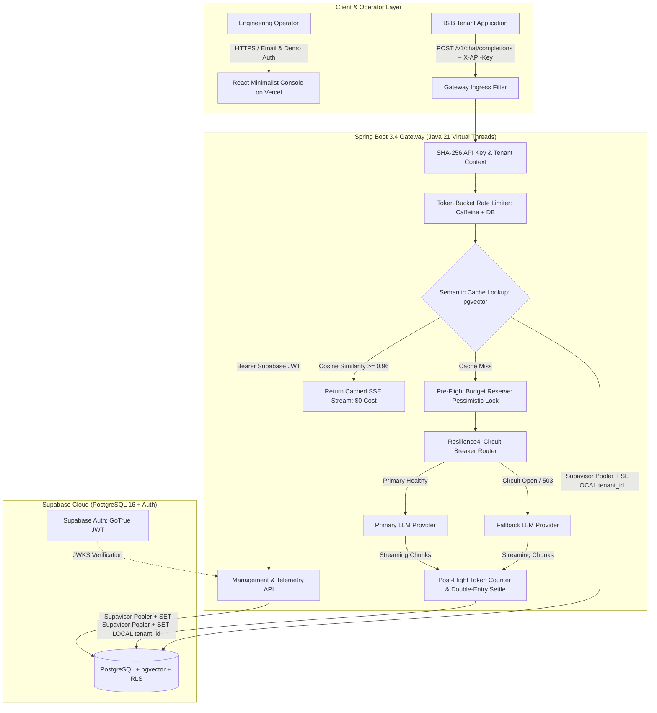
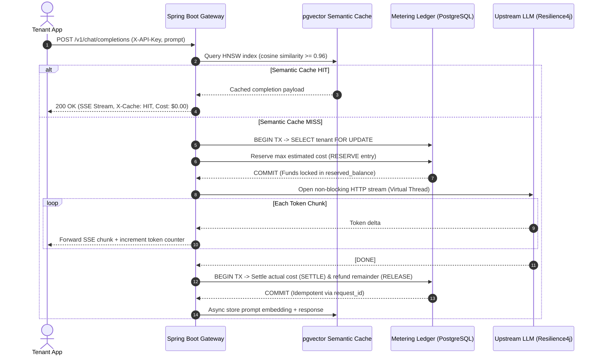
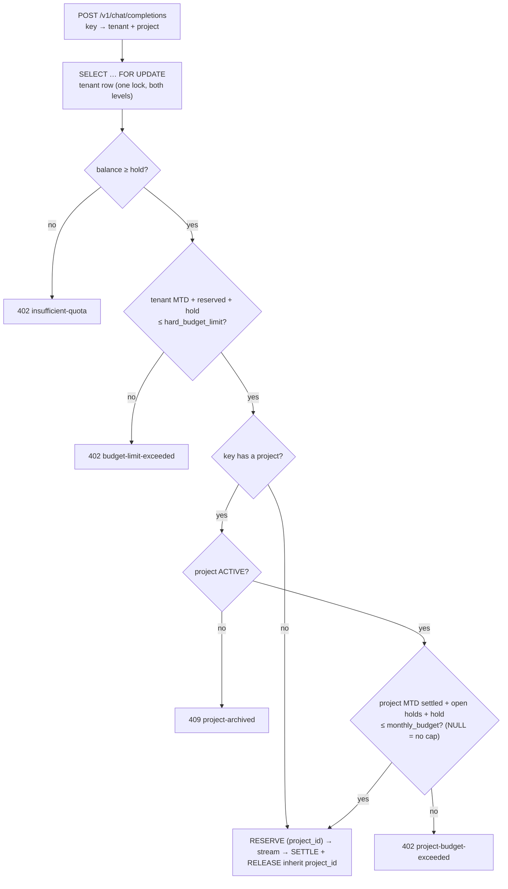
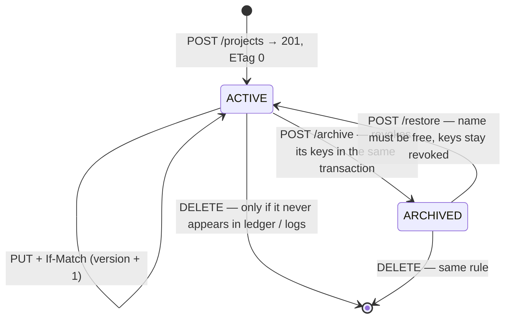
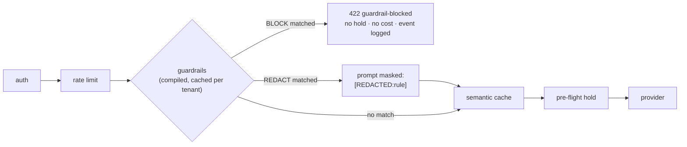
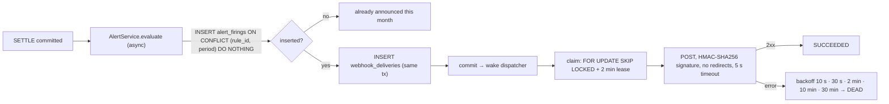
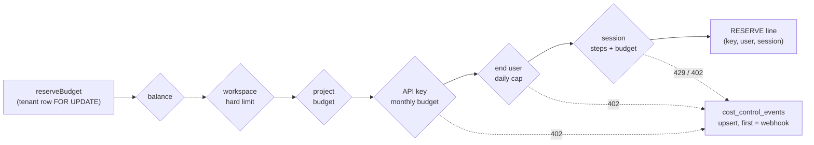

# System Design: AetherGate — Multi-Tenant AI Gateway & Token Metering Engine

## 1. Executive Summary
**AetherGate** is a multi-tenant AI Gateway, semantic caching layer, and deterministic token metering engine built with **Java 21 (Spring Boot 3.4)**, **Supabase PostgreSQL (`pgvector` + Row-Level Security)**, and **React**. It sits as a unified control plane between B2B SaaS applications and upstream LLM providers (OpenAI, Anthropic, Gemini), solving four critical production bottlenecks:
1. **Uncontrolled LLM Spend & Race Conditions:** Prevents concurrent requests from exceeding tenant budgets using two-phase *Pre-Flight Reserve / Post-Flight Settle* accounting.
2. **Redundant Inference Latency & Cost:** Cuts repeat query latency from ~1,200ms to <20ms using `pgvector` HNSW cosine similarity caching.
3. **Upstream Provider Outages:** Automatically fails over across LLM providers using **Resilience4j** Circuit Breakers without dropping client connections.
4. **Strict Multi-Tenant Isolation:** Enforces tenant data boundaries at the PostgreSQL kernel level via **Row-Level Security (RLS)** paired with Java 21 `ScopedValue` context propagation.

---

## 2. High-Level System Architecture

---

## 3. Core Sequence Flows

### 3.1. Two-Phase Token Metering & Streaming Flow
Because LLM streaming responses emit tokens incrementally, the exact completion cost is unknown until the stream terminates. AetherGate uses a **Reserve-Stream-Settle** protocol inspired by payment authorization holds:

---

## 4. Database Schema & Multi-Tenant Isolation

### 4.1. Entity-Relationship Model

```mermaid
erDiagram
    TENANTS ||--o{ API_KEYS : issues
    TENANTS ||--o{ PROVIDER_CONFIGS : configures
    TENANTS ||--o{ LEDGER_ENTRIES : records
    TENANTS ||--o{ LLM_REQUEST_LOGS : logs
    TENANTS ||--o{ SEMANTIC_CACHE : caches
    TENANTS ||--o{ PROJECTS : "splits spend into"
    PROJECTS |o--o{ API_KEYS : groups
    PROJECTS |o--o{ LEDGER_ENTRIES : "is charged"
    PROJECTS |o--o{ LLM_REQUEST_LOGS : attributes
    TENANTS ||--o{ GUARDRAIL_RULES : defines
    GUARDRAIL_RULES |o--o{ GUARDRAIL_EVENTS : "fired as"
    TENANTS ||--o{ TENANT_MEMBERS : "invites / grants roles"
    TENANTS ||--o{ AUDIT_EVENTS : "append-only history"
    TENANTS ||--o{ WEBHOOK_ENDPOINTS : notifies
    WEBHOOK_ENDPOINTS ||--o{ WEBHOOK_DELIVERIES : "outbox rows"
    TENANTS ||--o{ ALERT_RULES : "budget alerts"
    PROJECTS |o--o{ ALERT_RULES : scopes
    ALERT_RULES ||--o{ ALERT_FIRINGS : "once per month"
    TENANTS ||--o{ PROMPT_TEMPLATES : "prompt library"
    PROMPT_TEMPLATES ||--|{ PROMPT_TEMPLATE_VERSIONS : "immutable versions"
    PROMPT_TEMPLATES |o--o{ LLM_REQUEST_LOGS : "version recorded"

    TENANTS {
        uuid id PK
        uuid owner_user_id
        string name
        string slug
        numeric available_balance_usd "NUMERIC(19,8)"
        numeric reserved_balance_usd "NUMERIC(19,8)"
        numeric hard_budget_limit_usd "NUMERIC(19,8)"
    }

    PROJECTS {
        uuid id PK
        uuid tenant_id FK "UNIQUE (tenant_id, id)"
        string name "unique among ACTIVE, case-insensitive"
        string description
        numeric monthly_budget_usd "NULL = no cap"
        string status "ACTIVE, ARCHIVED"
        bigint version "optimistic lock / ETag"
        timestamp archived_at
    }

    GUARDRAIL_RULES {
        uuid id PK
        uuid tenant_id FK "UNIQUE (tenant_id, id)"
        string name "unique per tenant, case-insensitive"
        string rule_type "KEYWORDS, REGEX, PII_EMAIL, PII_CARD"
        string pattern "only KEYWORDS / REGEX (CHECK)"
        string action "BLOCK, REDACT"
        boolean is_enabled
        bigint version "ETag"
    }

    GUARDRAIL_EVENTS {
        uuid id PK
        uuid tenant_id FK
        uuid rule_id FK "(tenant_id, rule_id) ON DELETE SET NULL"
        string rule_name "snapshot: survives rename/delete"
        string action
        string request_id
        int matches
    }

    API_KEYS {
        uuid id PK
        uuid tenant_id FK
        string key_prefix
        string key_hash "SHA-256"
        int rate_limit_rpm
        int rate_limit_tpm
        boolean is_active
        uuid project_id FK "(tenant_id, project_id) ON DELETE SET NULL"
    }

    LEDGER_ENTRIES {
        uuid id PK
        uuid tenant_id FK
        string request_id
        string entry_type "TOP_UP, RESERVE, SETTLE, RELEASE"
        numeric amount_usd "NUMERIC(19,8)"
        numeric balance_after_usd "NUMERIC(19,8)"
        uuid project_id FK "(tenant_id, project_id) RESTRICT"
        timestamp created_at
    }

    LLM_REQUEST_LOGS {
        uuid id PK
        uuid tenant_id FK
        string request_id
        string provider_used
        string model_used
        int prompt_tokens
        int completion_tokens
        numeric total_cost_usd
        int latency_ms
        int ttft_ms
        string cache_status
        boolean failover_triggered
        uuid project_id FK "(tenant_id, project_id) RESTRICT"
    }

    SEMANTIC_CACHE {
        uuid id PK
        uuid tenant_id FK
        text prompt_text
        vector embedding "vector(384) HNSW"
        text response_text
        timestamp expires_at
    }
```

### 4.2. Defense-in-Depth Security Controls
1. **Row-Level Security (RLS):** Every tenant-scoped table enforces `tenant_id = NULLIF(current_setting('app.current_tenant_id', true), '')::uuid`. Even if an application-layer query omits a tenant predicate, PostgreSQL prevents cross-tenant reads or writes.
2. **Append-Only Ledger Immutability:** A database trigger (`BEFORE UPDATE OR DELETE ON ledger_entries`) blocks any modification or deletion of historical financial records.
3. **Zero-Trust API Key Storage:** Raw API keys (`ag_live_...`) are displayed once upon generation and stored solely as salted SHA-256 hashes.
4. **Tenant-safe foreign keys:** PostgreSQL checks foreign keys *without* RLS, so a plain `project_id` FK would let tenant B's row point at tenant A's project. Every project reference is the composite `(tenant_id, project_id) → projects (tenant_id, id)`, which makes a cross-tenant reference impossible even for the table owner.

### 4.3. Projects: cost centres with hierarchical budgets

A tenant splits its AI spend into **projects** (one per product or team). Every API key belongs to at most one project, every
`RESERVE`/`SETTLE`/`RELEASE` line carries the project it was charged to, and a project may have its own **monthly budget**
on top of the tenant's balance and hard limit.

| Rule | Where it is enforced |
|---|---|
| Name unique among **active** projects, case-insensitive (archived names can be reused) | service check **and** partial unique index `(tenant_id, lower(name)) WHERE status = 'ACTIVE'` (a race ends as 409, not 500) |
| Max 25 active projects per tenant | service (409) |
| Edits are conditional: `PUT` needs `If-Match: "<version>"` | 428 if missing, 412 + `current_version` if stale, JPA `@Version` catches the last-instant race |
| A budget can never be set below the month's committed spend (settled + holds in flight) | service (409), so the invariant *spend ≤ budget* stays true; archive is the "stop now" lever |
| Archive revokes the project's active keys atomically; key caches are evicted **after commit** | `TransactionSynchronization.afterCommit` (no window in which a stale cache re-admits the key) |
| A project with metering history is never deleted | service check (409) + `ON DELETE RESTRICT` on ledger/log FKs; the ledger is append-only |
| Deleting an unused project leaves its keys unassigned | `ON DELETE SET NULL (project_id)` on the composite FK (PostgreSQL 15+ column list) |
| `RESERVE`, `SETTLE` and `RELEASE` of one request share one project | settle/release copy `project_id` from the hold; verified by the live audit |
| Moving a key to another project changes where *future* requests are charged; history stays put | `PATCH /tenant/api-keys/{id}` + key-cache eviction |

### 4.4. Guardrails: prompt policies enforced before anything is spent

| Concern | Design |
|---|---|
| Placement | After rate limiting (abuse still counts against RPM), **before** the semantic cache, the ledger and any provider: a blocked prompt costs nothing, and a redacted prompt is the only version the cache, the providers and the request log ever see. |
| Rule types | `PII_EMAIL`, `PII_CARD` (13–19 digits, card-network prefix 2–6 **and** Luhn checksum, so order numbers and millisecond timestamps do not match), `KEYWORDS` (whole words, case-insensitive, metacharacters quoted), `REGEX` (≤ 500 chars). |
| Precedence | Any BLOCK match wins and nothing is redacted; otherwise REDACT rules mask in order. |
| ReDoS | Java regex has no timeout, so the matcher reads the prompt through a `CharSequence` that checks a 25 ms deadline every 1,024 reads. A runaway pattern **fails closed** (the request is blocked), never open. Patterns that match the empty string are rejected at save time. |
| Validation | Every rule is compiled on save (invalid regex → 400 with the reason), never on the request path. |
| Caching | Compiled rules are cached per tenant (Caffeine, 30 s TTL); CRUD publishes `GuardrailsChanged` and a `@TransactionalEventListener` drops the entry **after commit**, so a disabled rule stops applying on the very next request. |
| Audit trail | `guardrail_events` stores the rule **name snapshot**, request id and match count; deleting a rule keeps its history. |
| CRUD | `GET/POST /tenant/guardrails`, `PUT /{id}` with `If-Match` (428/412), `PATCH /{id}` enable/disable, `DELETE /{id}`, `POST /test` dry run (nothing recorded). Max 20 rules. |

### 4.5. Model catalog and workspace settings

| Operation | Rule |
|---|---|
| `POST /tenant/providers` | OPENAI / ANTHROPIC / GEMINI only (the simulator type is internal); unique `(provider, lower(model))` per tenant (index + 409); appended at the end of the chain; max 6. |
| `PUT /tenant/providers/{id}` | New model name / prices; the **next** pre-flight hold uses them (holds are priced at the most expensive enabled model), holds already taken keep theirs. |
| `DELETE /tenant/providers/{id}` | Closes the priority gap (deferrable unique constraint); the last enabled model can never be removed (409). |
| `GET/PUT /tenant/settings` | Name + monthly hard limit. The limit can never be set below the month's committed spend (settled + reserved). The update takes the **same tenant row lock** as metering instead of an ETag (ADR-014). The shared demo workspace is read-only (403 `demo-read-only`). `/me` is refreshed after commit. |

### 4.6. Team members, roles and the audit log

| Concern | Design |
|---|---|
| Model | `tenants.owner_user_id` stays the primary OWNER (never a member row, so it can never be removed); `tenant_members` holds INVITED rows (SHA-256 token, 72 h expiry, no user) and ACTIVE rows (user, no token) — a CHECK constraint enforces exactly those two shapes. |
| Roles | `VIEWER < DEVELOPER < ADMIN < OWNER`. Enforced server-side by `RoleInterceptor` + `@RequiresRole`; **safe default** without an annotation: GET = Viewer, any write = Admin. |
| Escalation | You can only grant, change or remove roles strictly below your own (Owners manage Owners); nobody edits their own role; role changes use If-Match. |
| Workspace selection | One user can own a workspace and belong to others. The console sends `X-Workspace-Id`; membership is resolved per request (30 s cache per user, evicted after commit on any membership change), so a removed member is locked out on the next request. A stale header makes `/me` fall back to the default workspace. |
| Invitations | Single-use bearer tokens (`inv_…`, 40 base62 chars) shown once; redeemable only by the invited e-mail (from the verified JWT); accepting is an `UPDATE … WHERE status = 'INVITED'`, so two simultaneous accepts cannot both win. |
| Audit | Every console write — including refused ones (403) — is written to `audit_events` (actor, role, route template, target id, HTTP status). A trigger rejects UPDATE/DELETE, exactly like the ledger. |

### 4.7. Budget alerts and signed webhooks (transactional outbox)

| Concern | Design |
|---|---|
| Exactly once per month | Decided by the unique index `(rule_id, period)`; only the inserting transaction enqueues the webhook. |
| Outbox | Deliveries are rows written in the business transaction: rollback ⇒ no webhook; commit ⇒ durable even if the process dies before sending. |
| Multi-instance | `FOR UPDATE SKIP LOCKED` + lease; a crashed sender's lease simply expires. At-least-once; receivers de-duplicate on `X-AetherGate-Event-Id` (redelivery keeps it). |
| Signature | `X-AetherGate-Signature: t=<unix>,v1=<hex>` over `t + "." + body` (Stripe scheme): tamper-evident and replay-bounded. Secrets `whsec_…` shown once, rotatable. |
| SSRF | Save time: HTTPS only, no credentials, no internal names or private literals. **Every send**: re-resolve and require every address to be public (loopback, RFC 1918, link-local/metadata, CGNAT, ULA, multicast refused) — defeats DNS rebinding; redirects never followed. |
| Events | `budget.threshold_crossed`, `guardrail.blocked` (rule + request id, never the prompt), `api_key.rotated`, `member.joined`, `webhook.test`. |

### 4.8. API key policies and zero-downtime rotation

| Policy | Enforcement | Error |
|---|---|---|
| `expires_at` | checked per request in the API-key filter (the cached principal carries the instant) | 401 with a specific detail |
| `allowed_models` | requested model checked; `auto` routes **only** over allowed models, so the pre-flight hold is priced on them too; cache hits from another model are ignored | 403 `model-not-allowed` |
| `ip_allowlist` (CIDR, v4/v6) | client address from `X-Forwarded-For`, which Caddy always overwrites; the app port is not public | 403 `ip-not-allowed` |
| Edits | `PUT …/policy` with If-Match on the key's `@Version`; cache evicted immediately | 412 / 428 |
| Rotation | `POST …/rotate {grace_hours}`: successor inherits project, limits and restrictions (`rotated_from`); the old key expires after 0–168 h | `api_key.rotated` webhook |

### 4.9. Versioned prompt templates

| Concern | Design |
|---|---|
| Immutability | `prompt_template_versions` rows can never be updated (trigger); an edit is always version N+1. |
| Release control | `prompt_templates.active_version` is the only pointer; publishing / rolling back is an Admin action guarded by If-Match. Developers create drafts that never receive traffic. |
| Rendering | `{{variable}}` placeholders, single pass over the template (values are inserted literally, so user input cannot inject template syntax); missing variables → 400 listing all of them. Rendered messages then pass guardrails, cache and metering like any prompt. |
| Attribution | `llm_request_logs.template_id/template_version` (composite tenant-safe FK) → per-version requests, average cost, tokens, latency and cache-hit rate. A template that served traffic cannot be deleted (409). |
| API | Playground `template` field; gateway extension `"prompt_template": {"id": "<id or name>", "version"?, "variables": {…}}` on `/v1/chat/completions`. |

### 4.10. Request attribution: end users, agent sessions, cost tags (V8)

| Concern | Design |
|---|---|
| Ingestion | `X-AetherGate-User`, `X-AetherGate-Session`, `X-AetherGate-Tags: k=v,k2=v2` headers win over the OpenAI body fields `user` and `metadata` (`metadata.session_id` = session, every other key = tag). Validated before anything is reserved (ids `[A-Za-z0-9._:@/+=-]{1,128}`, ≤ 10 tags, lower-case keys) → `400` otherwise. The playground has the same three fields. |
| Storage | `llm_request_logs.end_user_id / session_id / tags JSONB (GIN jsonb_path_ops) / requested_model / routing_reason`, and **the same dimensions on every ledger line** (`api_key_id`, `end_user_id`, `session_id`) — caps are enforced from the ledger, never from telemetry. Audit check 12 proves logs and ledger agree. |
| Showback | `/analytics/attribution?dimension=project\|model\|provider\|api_key\|end_user\|tag:<key>`: spend, tokens, share, cache-hit ratio, latency, errors per group; **tag coverage** (share of spend carrying any tag) as a FinOps KPI. Group expressions are whitelisted; tag keys are bound parameters. |
| Explorer | `/analytics/requests` with filters `model, provider, project, api_key, end_user, session, tag=k:v (jsonb @>), cache, status, routing, q` + paging; unknown filters are `400`. `/analytics/sessions` (+ `/{id}` timeline with cumulative cost per step). |

### 4.11. Fine-grained spend caps and the runaway-agent guard

Every cap is "settled this period + holds still in flight + this hold ≤ cap", evaluated **under the same tenant row lock** as the balance, so N concurrent requests can never overshoot any level. Key budgets are per calendar month (`api_keys.monthly_budget_usd`, carried in the cached principal and evicted on change), end-user caps per UTC day, session caps for the session's lifetime; the step limit counts the session's `RESERVE` lines (a looping agent gets `429 session-step-limit`). A refused request writes one row per *(cap, scope, period)* in `cost_control_events` with `blocked_count + 1` (in its own transaction, after the reserve rolled back); the insert that **creates** the row (`RETURNING xmax = 0`) publishes `spend_cap.reached` exactly once.

### 4.12. Budget-aware model downgrade (soft limit)

`tenants.downgrade_at_pct` + `downgrade_model` (both or neither, DB check). When month-to-date settled spend reaches the threshold of the hard limit, the routing chain is reordered so the cheaper model answers first and the rest stay behind it as fallback (availability over savings). A key whose allow-list excludes that model keeps its normal chain. The decision is cached 5 s per tenant (a soft limit tolerates seconds of staleness; it saves a query per request) and invalidated on change. Responses carry `X-AetherGate-Downgraded-To`, telemetry `downgraded_to`, the log row `routing_reason = DOWNGRADE`.

### 4.13. Forecast, anomaly detection, savings advisor, FOCUS export

| Feature | Design |
|---|---|
| Forecast | From the ledger: MTD + trailing-7-day daily run rate × remaining days; 80 % band = ±1.28 σ(last 14 daily totals) × √remaining; also the naive linear projection, the date the hard limit is reached, credit runway, week-over-week trend and a per-project outlook (ON_TRACK / AT_RISK ≥ 90 % / OVER_BUDGET / NO_BUDGET). |
| Anomalies | Hourly spend judged against the previous 168 h with a **robust z-score**: `(x − median) / (1.4826 · MAD)`, σ floored at max(10 % of median, $0.0005); anomalous when z ≥ 4, x ≥ 2 × median and x ≥ $0.01; CRITICAL at z ≥ 8. Median/MAD cannot be inflated by the spike itself. Scanned after settlements (≤ 1× per tenant per minute, off the response path) and by the seeder; `cost_anomalies UNIQUE (tenant_id, bucket_start)` makes the `cost.anomaly_detected` webhook exactly-once, with the top contributor (model · session / user · share). |
| Savings advisor | Ranked recommendations with evidence and, where computable from real token counts × catalog prices, a monthly $ figure: model right-sizing (avg completion ≤ 500 tokens, cheapest enabled model ≥ 30 % cheaper), prompt bloat (input ≥ 6× output → 30 % trim), cache opportunity (< 15 % hit ratio), unreliable primary (≥ 5 % failovers), idle keys (14 d), heavy keys without a cap (≥ 20 % of spend), projects without budget, no budget alerts, and "enable the soft limit" when the forecast reaches ≥ 90 % of the limit. |
| FOCUS export | `GET /analytics/export/focus?month=YYYY-MM` → FinOps Foundation **FOCUS 1.2** column names (BilledCost, EffectiveCost, ListCost = billed + cache savings, ConsumedQuantity/Unit = tokens, PricingUnit = 1M Tokens, ServiceCategory "AI and Machine Learning", SubAccount = project, Tags JSON, `x_` columns for tokens, requests, cache hits/savings). One row per UTC day × project × provider × model × key × tag set; BilledCost sums exactly to the ledger's settled spend (tested). RFC 4180 quoting and formula-injection-safe cells. |

---

## 5. Architecture Decision Records (ADRs)

### ADR-001: Java 21 Virtual Threads over Reactive WebFlux
- **Decision:** Use Spring Boot 3.4 on Java 21 with `spring.threads.virtual.enabled=true` instead of Project Reactor / WebFlux.
- **Rationale:** LLM gateway workloads are heavily I/O-bound (waiting hundreds of milliseconds to seconds for upstream token streams). Virtual Threads provide high concurrency (~10,000+ concurrent streams on minimal RAM) while preserving straightforward imperative code, readable stack traces, and clean JPA transaction boundaries.

### ADR-002: `NUMERIC(19, 8)` Fixed-Point Arithmetic for Micro-Cent Metering
- **Decision:** Represent all USD balances and per-token costs as `NUMERIC(19, 8)` in PostgreSQL and `java.math.BigDecimal` in Java.
- **Rationale:** Individual LLM tokens cost fractions of a cent (e.g., `$0.00000015` per token). Floating-point types (`double`/`float`) introduce cumulative rounding drift over millions of requests. Fixed 8-decimal precision guarantees exact reconciliation between `RESERVE`, `SETTLE`, and `RELEASE` entries.

### ADR-003: Dual-Layer Rate Limiting (Caffeine + PostgreSQL Bucket Sync)
- **Decision:** Enforce RPM (Requests Per Minute) and TPM (Tokens Per Minute) limits using an in-memory **Caffeine** Token Bucket backed by PostgreSQL minute-window counters.
- **Rationale:** Eliminates the operational overhead and cost of hosting a dedicated Redis cluster on free-tier infrastructure while still blocking abusive traffic bursts in sub-millisecond memory lookups.

### ADR-004: Supabase Auth + Spring Security OAuth2 Resource Server
- **Decision:** Delegate user identity, password hashing, and session management to Supabase Auth, while Spring Boot validates incoming Bearer JWTs via Supabase's JWKS endpoint.
- **Rationale:** Decouples user authentication from core gateway routing, enabling seamless login on the Vercel React frontend while keeping the Spring Boot backend completely stateless.
### ADR-005: `SET LOCAL ROLE` to make RLS real on Supabase
- **Decision:** Every tenant-scoped transaction runs `set_config('app.current_tenant_id', …, true)` **and** switches to a dedicated `aethergate_app` role (`NOLOGIN NOBYPASSRLS`) via `set_config('role', …, true)`, in one round trip. Tables additionally use `FORCE ROW LEVEL SECURITY`.
- **Rationale:** Supabase's `postgres` role has `BYPASSRLS` (and test containers run as superuser), so policies alone would silently not apply. Both settings are transaction-local, so pooled connections return clean. Pre-tenant lookups (API key hash → tenant, JWT `sub` → tenant) are the only owner-level queries and live in one class (`TenantDirectoryService`).

### ADR-006: Circuit breakers keyed per (tenant, provider)
- **Decision:** Resilience4j breakers are named `tenantId:PROVIDER`; failover is allowed only before the first token is forwarded.
- **Rationale:** In a shared demo, one visitor's chaos experiment must not open the breaker for every tenant. A production deployment that wants shared upstream health would key by provider endpoint. Failing over after tokens were streamed would corrupt the client's stream, so a mid-stream failure ends the request and bills only delivered tokens.

### ADR-007: Hold priced at the most expensive provider in the chain
- **Decision:** `RESERVE = max over enabled providers of cost(prompt_tokens, max_tokens)`, rounded *up*; `SETTLE` rounds half-up and is capped at the hold.
- **Rationale:** Guarantees `actual ≤ reserved` even when a request fails over to a pricier model, so a settlement can never overdraw the balance. A `CHECK (available_balance_usd >= 0)` constraint is the last line of defence.

### ADR-008: Deterministic offline embeddings + built-in LLM simulator
- **Decision:** 384-dim feature-hashing embeddings (word unigrams/bigrams + char trigrams, FNV-1a, sub-linear TF, L2-normalised) computed in Java; providers without an API key are served by a deterministic streaming simulator.
- **Rationale:** The whole platform — cache hits, failover, metering — works end-to-end for an evaluator at $0 and with zero external calls. Real OpenAI / Anthropic / Gemini keys switch the respective provider to its live streaming client without code changes.

### ADR-009: Money as decimal strings on the wire
- **Decision:** `BigDecimal` is serialised with `toPlainString()` as a JSON **string**; the React console formats it by string manipulation.
- **Rationale:** JavaScript numbers are binary doubles; `0.00142000` must survive the round trip to the screen unchanged.

### ADR-010: Hierarchical budgets checked under the existing tenant lock
- **Decision:** The project budget check runs inside `reserveBudget`, after the tenant checks, while the tenant row is held with `SELECT … FOR UPDATE`. Committed project spend = month-to-date `SETTLE` + project holds still in flight (a `RESERVE` without `SETTLE`/`RELEASE`), computed from the ledger rather than a denormalised counter.
- **Rationale:** One lock already serialises every money movement of a tenant, so both levels are race-free with no new locking (20 concurrent $0.10 holds on a $1 project → exactly 10 pass, tested). Deriving the number from the append-only ledger means there is no second balance that could drift.
- **Trade-off:** A sum per reservation instead of a counter; indexed by `(tenant_id, project_id, entry_type, created_at)` it stays cheap at this scale.

### ADR-011: Composite `(tenant_id, project_id)` foreign keys
- **Decision:** `projects` exposes `UNIQUE (tenant_id, id)`; `api_keys`, `ledger_entries` and `llm_request_logs` reference it with composite FKs.
- **Rationale:** RLS filters what a session can *see*, but FK validation runs as the table owner and ignores RLS. Without the composite key, a bug that passed another tenant's project id would be accepted. Now the database itself refuses it (tested as the table owner).

### ADR-012: Archive instead of delete, optimistic concurrency via ETag / If-Match
- **Decision:** Projects with history are archived (soft lifecycle state), never deleted; `DELETE` is allowed only for never-used projects. Edits are full replacements (`PUT`) guarded by `If-Match` on a JPA `@Version` ETag.
- **Rationale:** The ledger is append-only and must keep pointing at the project it charged, so history wins over tidiness. Two admins editing the same budget in two tabs is realistic; the second save gets 412 with the current version instead of silently overwriting the first (the "lost update").

### ADR-013: Guardrails sit before the cache and fail closed
- **Decision:** Enforce tenant prompt policies inside the gateway pipeline, after rate limiting and before the semantic cache and the pre-flight hold; a regex that exceeds its time budget blocks the request.
- **Rationale:** Masking after the cache would leave PII in cached prompts; blocking after the hold would create ledger noise for requests that were never allowed. A policy engine that "fails open" under a crafted ReDoS input is a bypass, so timeouts are treated as a match.

### ADR-014: Workspace settings use the row lock, not an ETag
- **Decision:** `PUT /tenant/settings` has no `If-Match`; it locks the tenant row (`SELECT … FOR UPDATE`) and validates the new limit against committed spend inside that lock.
- **Rationale:** The tenant row's `@Version` advances with every reservation, so an ETag would be stale within milliseconds under traffic. Projects and guardrails, which only change through CRUD, keep optimistic `If-Match`.

### ADR-015: RBAC in an interceptor with a deny-by-default rule for writes
- **Decision:** One `RoleInterceptor` resolves workspace + role for every console request and compares it with `@RequiresRole`; without an annotation, reads need Viewer and writes need Admin.
- **Rationale:** Scattered `if (role…)` checks are forgotten on new endpoints. With a closed default, a new endpoint is admin-only until someone deliberately opens it, and the same hook writes the audit trail (including refusals).

### ADR-016: Primary owner on the tenant row, members in a separate table
- **Decision:** Keep `tenants.owner_user_id` as the non-removable primary owner; `tenant_members` stores invitations and additional members.
- **Rationale:** "The last owner can never be removed" becomes structurally impossible instead of a race-prone count check, and the existing demo/owner binding keeps working unchanged.

### ADR-017: Transactional outbox + database-decided idempotency for alerts
- **Decision:** Alert firings are deduplicated by a unique index and webhooks are written as outbox rows in the same transaction; a dispatcher sends after commit using `SKIP LOCKED` leases.
- **Rationale:** Sending HTTP inside a transaction announces facts that may roll back; sending after commit without a durable record loses them on a crash. A unique index is the only dedup that survives concurrency across instances.

### ADR-018: SSRF defence re-checked on every delivery
- **Decision:** Validate webhook URLs at save time **and** re-resolve and validate every target address before each send; never follow redirects.
- **Rationale:** A check at save time alone is defeated by DNS changes (rebinding) and redirects; on a cloud VM the metadata endpoint (169.254.169.254) would hand out instance credentials.

### ADR-019: Immutable prompt versions with a movable "active" pointer
- **Decision:** Versions are append-only rows; publishing is a pointer move with optimistic concurrency; requests record the version used.
- **Rationale:** Rollback becomes instant and safe, and cost/latency can be compared per version because history is never rewritten.

### ADR-020: Attribution dimensions on the ledger, not only on the request log
- **Decision:** `api_key_id`, `end_user_id`, `session_id` are written on RESERVE/SETTLE/RELEASE (copied from the RESERVE on clearing).
- **Rationale:** Caps must be checked under the tenant lock against money that is certain; the request log is written after streaming and can lag or be missing on a crash. An audit check keeps both in agreement.

### ADR-021: All spend caps under the one tenant row lock
- **Decision:** Key, end-user and session caps reuse the existing `SELECT … FOR UPDATE` on the tenant row instead of per-scope locks or counters.
- **Rationale:** One lock order means no deadlocks and no overshoot at any level; the extra indexed sums cost microseconds next to an LLM call. Per-key/user counters in Caffeine would drift across instances.

### ADR-022: Exactly-once notifications decided by unique constraints
- **Decision:** `cost_control_events (tenant, kind, scope, period)` upsert with `RETURNING xmax = 0`, and `cost_anomalies (tenant, hour)` with `ON CONFLICT DO NOTHING`; only the creating statement enqueues the webhook (same transaction, outbox).
- **Rationale:** Same principle as alert firings (ADR-017): the database, not timing in the application, decides who announces an event.

### ADR-023: Robust statistics for anomaly detection
- **Decision:** Median + MAD over a 168-hour trailing window with absolute floors, instead of mean + standard deviation or an ML model.
- **Rationale:** A spike inflates the mean and σ it is compared with; median/MAD do not. Explainable in one sentence, no training data, cheap enough to run after settlements.

### ADR-024: Soft limit reorders the chain instead of hard-switching the model
- **Decision:** Past the threshold the cheap model is moved to the front; other models remain as fallback; the hold still covers the whole chain.
- **Rationale:** A cost control must not turn into an outage when the cheap provider is down, and the ledger's worst-case hold guarantee (ADR-007) stays intact.

---

## 6. As built

| Area | Implementation |
|---|---|
| Gateway | `POST /v1/chat/completions` (OpenAI-compatible, SSE or JSON), `GET /v1/models`; auth by `X-API-Key` or `Authorization: Bearer ag_live_…` |
| Console API | `/api/v1/me`, `/dashboard/overview?range=24h\|7d\|30d`, `/dashboard/ledger`, `/tenant/api-keys` (+ `PATCH` to move a key between projects), `/tenant/projects` (list, create, get, `PUT` with If-Match, `/archive`, `/restore`, `DELETE`), `/tenant/guardrails` (CRUD + `PATCH` toggle + `/test` dry run), `/tenant/settings` (GET/PUT), `/tenant/providers` (add, reprice, delete, reorder, toggle), `/tenant/api-keys/{id}/policy` (PUT If-Match), `/tenant/api-keys/{id}/rotate`, `/workspaces`, `/invitations/accept`, `/tenant/members` (invite, resend, PATCH role If-Match, DELETE), `/tenant/audit`, `/tenant/webhooks` (CRUD, rotate-secret, test, deliveries, redeliver), `/tenant/alerts`, `/tenant/prompts` (CRUD, versions, active-version If-Match, render), `/tenant/top-up`, `/playground/completions` (optional `project_id`, `end_user`, `session_id`, `tags`), `/auth/demo-session`, `/tenant/cost-controls` (GET, PUT Admin), `/analytics/attribution`, `/analytics/end-users`, `/analytics/sessions` (+ `/{id}`), `/analytics/requests`, `/analytics/forecast`, `/analytics/anomalies`, `/analytics/recommendations`, `/analytics/export/focus` |
| Errors | RFC 7807 `application/problem+json` with stable `type` URIs (`insufficient-quota` 402, `budget-limit-exceeded` 402, `rate-limited` 429 + `Retry-After`, `providers-unavailable` 503, `upstream-interrupted` 502, `project-budget-exceeded` 402, `project-archived` 409, `conflict` 409, `stale-version` 412, `precondition-required` 428, `guardrail-blocked` 422, `demo-read-only` 403, `insufficient-role` 403, `workspace-access-denied` 403, `ip-not-allowed` 403, `model-not-allowed` 403, `invitation-invalid` 410, `invitation-email-mismatch` 403, `key-budget-exceeded` 402, `end-user-cap-exceeded` 402, `session-budget-exceeded` 402, `session-step-limit` 429) |
| Database | Schema `aethergate` (shares a Supabase project safely, not exposed via PostgREST), Flyway V1–V8 (V4 third tenant + named logins, V5 projects with composite tenant-safe FKs, V6 guardrails + model catalog, V7 members + audit, webhooks outbox + alerts, key policies, prompt templates, V8 attribution columns on logs and ledger, key/end-user/session caps, soft-limit downgrade, cost-control events, cost anomalies), HNSW index, append-only trigger, RLS USING + WITH CHECK on all tenant tables |
| Demo login | Server-side Supabase password grant; self-healing (resets the demo user via the GoTrue admin API if someone changed its password) |

## 7. Quality gates

| Gate | Result |
|---|---|
| JUnit 5 + AssertJ + Mockito | 163 tests (unit, Testcontainers `pgvector/pgvector:pg17` integration, MockMvc API, ArchUnit) |
| JaCoCo (enforced in `mvn verify`) | ≥ 85 % lines **and** branches — currently ~96 % lines / ~86 % branches (after V8: 96.3 % / 86.4 %) |
| Concurrency | 20 simultaneous $0.10 holds on a $1.00 balance → exactly 10 succeed, balance never negative; the same against a $1.00 **project** budget |
| ArchUnit | controllers never touch repositories, no JPA entities in web layer, DTOs are records, no `synchronized` (virtual-thread pinning), no secret constants |
| Live audit (`--aethergate.tool=audit`) | 17 invariant checks (V8 adds: ledger lines carry the request's key / end user / session; anomalies at most once per tenant and hour) against the production database (funds equation, hold conservation, per-request split, one project per request, project spend ≤ budget, no holds after archive, RLS visibility incl. projects, guardrails, members, webhooks, alerts and prompts, templated requests point at an existing version, alerts fired at most once per month, trigger, vector shape, key hashing) |
