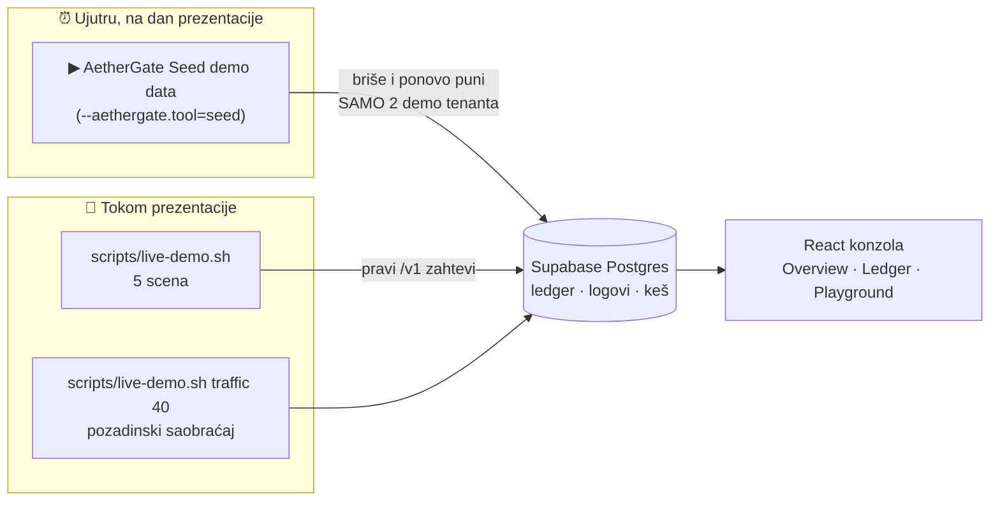
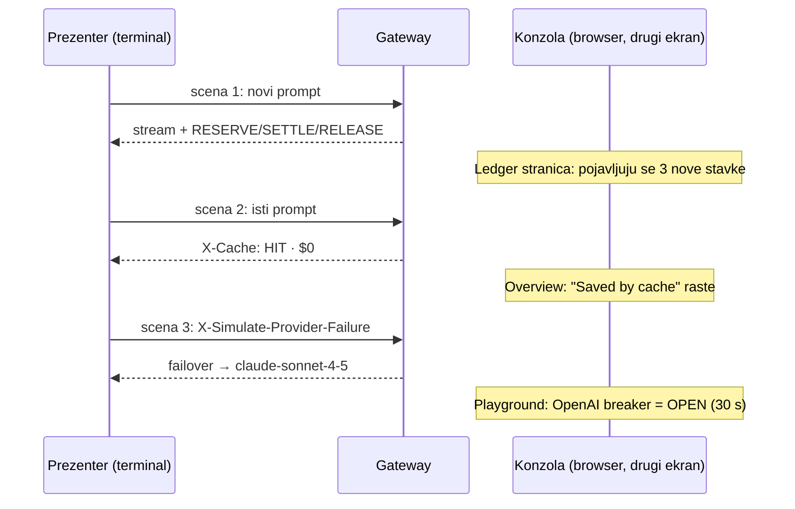

# Test podaci i živa demonstracija: kako da prezentacija "živi"

> Ideja u jednoj rečenici: **istorija od 30 dana se generiše jednom komandom (seed), a tokom same prezentacije
> skripta pravi *pravi* saobraćaj. Publika vidi grafikone sa podacima, a zatim gleda kako se brojevi menjaju uživo.**



---

## 1. Istorijski podaci: seed alat

### Šta generiše

| | Vortex AI Labs | Helix Robotics |
|---|---|---|
| Zahteva u 30 dana | 1.450 | 900 |
| Provajderi (primarni → rezervni) | gpt-4o → claude-sonnet-4-5 | claude-haiku-4-5 → gemini-2.5-flash |
| Keš HIT-ova (realno ~20%) | ~280 | ~200 |
| Failover-a (~3%) i ispada oba provajdera (~0,4%) | ✔ | ✔ |
| Dopune kredita | $100 početno + $50 karticom | $100 |

### Zašto podaci izgledaju *stvarno*, a ne nasumično

```
 saobraćaj po satu (radni dan)                 cena po zahtevu
  ▁▁▁▂▃▅▇██▇▆▇██▇▅▃▂▁▁                          tačno po cenovniku modela
  00h      12h      23h                         (CostCalculator, ISTA klasa kao gateway)
```

- **Dnevni ritam:** vrh oko 14h (UTC), noću ~15%, a vikendom ~45% saobraćaja radnog dana.
- **Rast:** saobraćaj blago raste kroz 30 dana (70% → 130%), kao kod proizvoda koji dobija korisnike.
- **Realan keš:** 60% promptova dobija jedinstven sufiks `(ref #48213)`, kao korisnik koji pita o konkretnom
  tiketu. Takav prompt se nikad ne ponavlja i ne može biti keširan. Rezultat je ~20% HIT-ova, a ne nerealnih 70%.
- **Ista pravila kao produkcija:** seed rezerviše po najskupljem provajderu u lancu, pa naplaćuje i vraća ostatak.
  Svaki zahtev u ledger-u ima tačno `RESERVE = SETTLE + RELEASE`.
- **Deterministički:** `Random` ima fiksni seed po tenantu, pa svaki put nastaju isti brojevi.
- **Topli keš:** promptovi iz poslednjih 24h ostaju u semantičkom kešu, pa ih Playground odmah vraća kao HIT.

### Bezbednost: šta seed briše

Seed briše i ponovo puni **samo dva demo tenanta**, po fiksnim UUID-ovima, u jednoj transakciji.
Pravi tenanti i drugi projekti u istoj bazi se ne diraju. Na kraju se automatski pokreće
**audit od 10 provera**, na primer:
- da li je ledger izbalansiran;
- da li se saldo poklapa sa zbirom stavki;
- da li RLS skriva tuđe redove.

```
>> Invariant audit
  PASS  1. Funds equation: TOP_UP - SETTLE = available + reserved (every tenant)
  PASS  2. Holds: RESERVE = SETTLE + RELEASE + open reservations
  ...
  PASS  7. RLS isolation across all tenant tables     2136 foreign ledger rows exist, 0 visible
  PASS  8. Ledger is append-only (UPDATE rejected by trigger)
  ...
  10/10 checks passed
```

### Kako se pokreće (3 načina)

| Gde | Kako |
|---|---|
| **IntelliJ** | Run konfiguracija **AetherGate Seed demo data**: ▶ (proces ispiše izveštaj i audit, pa se sam ugasi) |
| Terminal | `cd backend && mvn spring-boot:run -Dspring-boot.run.arguments=--aethergate.tool=seed` |
| Produkcijski server | `ssh ubuntu@138.2.169.195 'cd ~/aethergate/deploy && sudo docker compose run --rm gateway --aethergate.tool=seed'` |

Samo provera, bez upisa: konfiguracija **AetherGate Audit ledger** (`--aethergate.tool=audit`).

> ⏰ **Pokreni seed ujutru na dan prezentacije.** Podaci su relativni u odnosu na *sada*: poslednjih 30 dana,
> a keš važi 24h. Stari seed bi pokazivao "prazan danas" na grafikonu od 24h.

---

## 2. Živa demonstracija: `scripts/live-demo.sh`

Skripta ima 5 scena. Svaka dokazuje jednu tvrdnju i čeka **Enter**, da bi ti pričao dok publika gleda.

```bash
./scripts/live-demo.sh                             # nad živim Oracle API-jem
API=http://localhost:8088 ./scripts/live-demo.sh   # nad lokalnim backend-om iz IntelliJ-a
./scripts/live-demo.sh traffic 40                  # samo 40 zahteva, da se dashboard pomera
```

| Scena | Šta publika vidi (stvaran izlaz) | Šta dokazuje |
|---|---|---|
| **1 · Streaming i metering** | tekst se "kuca" token po token, zatim `model=gpt-4o RESERVE $0.00775200 = SETTLE $0.00159000 + RELEASE $0.00616200` | Dvofazna naplata, tačna do 8 decimala |
| **2 · Semantički keš** | `X-Cache: HIT`, cena $0 | pgvector pronalazi isto pitanje |
| **3 · Haos** | `served by: claude-sonnet-4-5 (primary is gpt-4o)` · `attempts: OPENAI: circuit OPEN, skipped` | Failover pre prvog tokena; circuit breaker |
| **4 · Rate limit** | `#1-3 → 200`, `#4 → 429 Retry-After: 14s` | Token bucket po API ključu (privremeni ključ se zatim briše) |
| **5 · Dokaz u brojevima** | saldo, rezervisano i `2082 foreign rows in DB · 0 visible` | Row-Level Security u bazi |



> **Savet za scenu:** otvori konzolu na drugom ekranu (Ledger ili Overview) i osvežavaj je posle svake scene.
> Publika vidi da terminal i dashboard pričaju istu priču iz iste baze.

---

## 3. Bez terminala: sve se može i kliktanjem u konzoli

1. https://aethergate-console.vercel.app → **Continue with Demo Workspace** otvara Vortex tenant sa 30 dana istorije.
2. **Playground & Chaos:** pošalji prompt, pa isti ponovo (keš HIT ⚡). Zatim uključi *Simulate provider failure*,
   pa breaker prelazi u OPEN i dolazi do failover-a.
3. **Ledger Audit:** filtriraj po `request_id` i pokaži tri stavke istog zahteva.
4. **API Keys & Routing:** prevuci provajdere da promeniš prioritet, napravi ključ sa malim RPM-om, pa ga opozovi.

---

## 4. Ček-lista pre prezentacije

- [ ] Ujutru: ▶ **AetherGate Seed demo data** i proveri da je audit `10/10 checks passed`.
- [ ] `curl https://138-2-169-195.sslip.io/actuator/health` vraća `UP`.
- [ ] Otvori https://aethergate-console.vercel.app i klikni *Continue with Demo Workspace* (prvi login malo traje).
- [ ] Jednom "na suvo" pokreni `./scripts/live-demo.sh` (između pokretanja sačekaj 30 s, da se breaker zatvori).
- [ ] Rezervni plan bez interneta: backend iz IntelliJ-a i `API=http://localhost:8088`.
