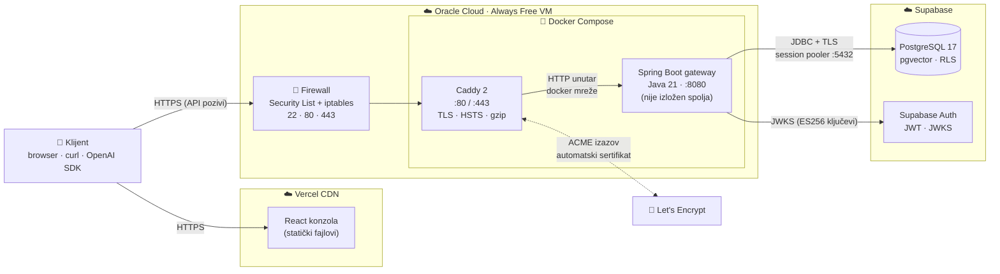
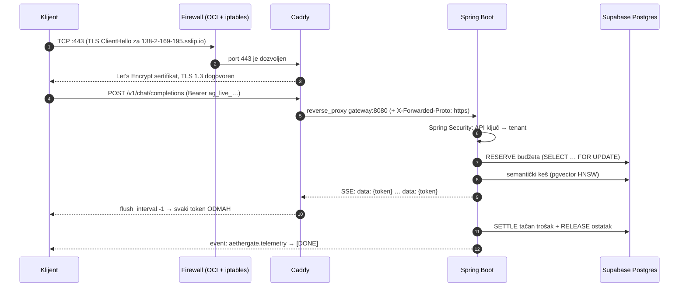
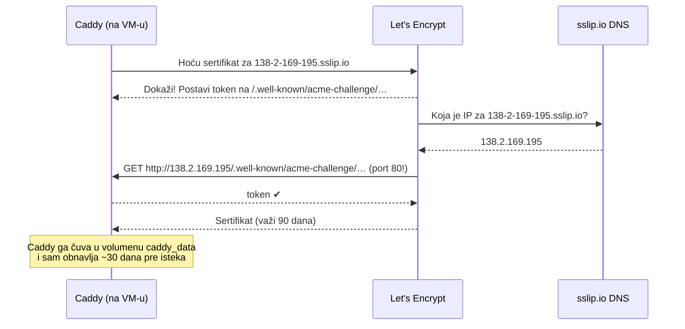
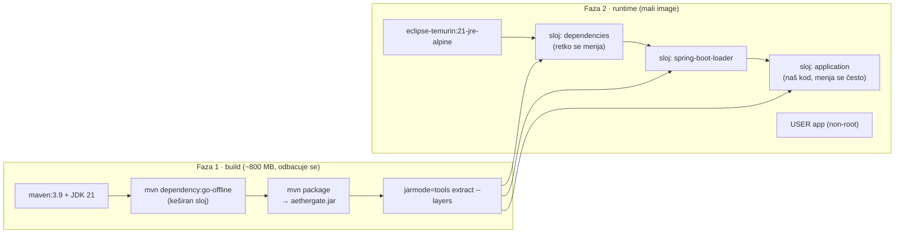

# Kako je AetherGate deployovan: slikovito objašnjenje

> **Konzola:** https://aethergate-console.vercel.app · **Živi API:** `https://138-2-169-195.sslip.io`. Probaj [`/actuator/health`](https://138-2-169-195.sslip.io/actuator/health).
>
> Test podaci i skripta za živu demonstraciju: [DEMO_DATA_AND_LIVE_DEMO.md](DEMO_DATA_AND_LIVE_DEMO.md).
>
> Dijagrami su u Mermaid formatu. GitHub i VS Code ih crtaju automatski.

---

## 1. Velika slika (u jednoj rečenici)

**Korisnikov zahtev ide preko interneta do Oracle Cloud VM-a. Tamo Caddy otvara HTTPS i prosleđuje zahtev
Spring Boot kontejneru. Spring Boot čita i piše u Supabase PostgreSQL, a odgovor *strimuje* nazad token po token.**



**Ključna ideja:** frontend i backend su odvojeni, svaki na platformi koja mu najviše odgovara.
- Statiku servira CDN (Vercel).
- Dugotrajni Java proces sa streamingom radi na pravom VM-u, gde nema "cold start" uspavljivanja.
- Bazu i autentikaciju vodi Supabase kao managed servis.

---

## 2. Put jednog zahteva, korak po korak



Šta se dešava u brojevima (stvarno izmereno):

| Korak | Vreme |
|---|---|
| HTTP → HTTPS redirect (Caddy) | `308` odmah |
| Bez API ključa | `401` (RFC 7807 JSON) |
| Dashboard upit sa JWT-om | ~0,7 s |
| Streaming odgovor (simulator gpt-4o) | ~2,9 s, token po token |
| RAM backend kontejnera | ~270 MB od limita 1 GB |

---

## 3. Šta je unutar VM-a: slojevi

```
┌─────────────────────────────────────────────────────────────────────┐
│  Oracle Cloud VCN                                                   │
│  ├─ Internet Gateway + ruta 0.0.0.0/0                               │
│  └─ Security List (Ingress):  TCP 22 · TCP 80 · TCP 443   ◄── sloj 1│
├─────────────────────────────────────────────────────────────────────┤
│  VM: Ubuntu 20.04 · aarch64 (Ampere)                                │
│  ├─ iptables INPUT: ACCEPT 22/80/443, sve ostalo REJECT   ◄── sloj 2│
│  │    (sačuvano sa netfilter-persistent → preživi reboot)           │
│  ├─ 2 GB swap (sigurnosna mreža za Maven build na 1 jezgru)         │
│  └─ Docker Engine 28 + Compose v2                                   │
│      ┌───────────────────────────────────────────────────────────┐  │
│      │ docker network: deploy_default                            │  │
│      │  ┌──────────────────────┐      ┌───────────────────────┐  │  │
│      │  │ caddy:2-alpine       │ ───► │ aethergate-backend    │  │  │
│      │  │ ports 80, 443, 443/udp│      │ expose 8080 (interno) │  │  │
│      │  │ volume: caddy_data   │      │ mem limit 1g          │  │  │
│      │  │  (sertifikati)       │      │ healthcheck readiness │  │  │
│      │  └──────────────────────┘      └───────────────────────┘  │  │
│      └───────────────────────────────────────────────────────────┘  │
│  ~/aethergate/deploy/.env  (chmod 600, tajne, NIJE u gitu)          │
└─────────────────────────────────────────────────────────────────────┘
```

**Zašto dva firewall-a?** Oracle ima *dva nezavisna* filtera:
1. **Security List** je mrežni filter u oblaku.
2. **iptables** je filter unutar samog Ubuntu image-a. Oracle ga isporučuje sa pravilom `REJECT` za sve osim SSH-a.

Česta zamka je otvoriti port samo u konzoli. Tada sajt i dalje ne radi, jer ga iptables odbija.

**Zašto port 8080 nije javan?** Gateway ima samo `expose`, ne `ports`, pa je dostupan isključivo Caddy-ju unutar
Docker mreže. Svaki spoljni saobraćaj *mora* da prođe kroz TLS.

---

## 4. Automatski HTTPS bez kupovine domena

Let's Encrypt ne izdaje sertifikate za gole IP adrese, a domen nismo hteli da kupujemo.
Rešenje je **sslip.io**, besplatni "magični" DNS koji ime pretvara nazad u IP:

```
138-2-169-195.sslip.io   ──DNS──►   138.2.169.195
```

Caddy zatim sam odradi ceo ACME protokol (HTTP-01 izazov):



Zato je **port 80** morao biti otvoren, iako sav korisnički saobraćaj ide na 443.

Ceo Caddyfile ima 20 linija:

```caddy
{$API_DOMAIN} {                                   # domen dolazi iz env promenljive
    encode zstd gzip { match { header Content-Type application/json* … } }
    header { Strict-Transport-Security "max-age=31536000; includeSubDomains"  -Server }
    reverse_proxy gateway:8080 {
        flush_interval -1                         # ⚡ ne baferuj SSE: token ide odmah
        health_uri /actuator/health/liveness
    }
}
```

> **`flush_interval -1`** je najvažnija linija za AI gateway. Bez nje bi proxy skupljao odgovor u
> bafer i korisnik bi video ceo tekst odjednom posle nekoliko sekundi, umesto "kucanja" token po token.

---

## 5. Kako nastaje Docker image (multi-stage build)



| Odluka | Zašto |
|---|---|
| **Multi-stage** | JDK i Maven ne završe u produkcijskom image-u, pa je image manji i ima manju površinu napada |
| **Slojeviti jar** | Kad se promeni samo naš kod, menja se samo poslednji sloj od nekoliko stotina KB |
| **JRE Alpine** | Mali bazni image; radi i na ARM64 (Oracle Ampere) bez ikakvih izmena |
| **non-root `app` korisnik** | Ako bi neko provalio u aplikaciju, nema root u kontejneru |
| `-XX:MaxRAMPercentage=60` | JVM sama računa heap iz limita kontejnera (1 GB → ~600 MB heap) |
| `-XX:+ExitOnOutOfMemoryError` | Pri OOM-u proces umire *čisto*, a `restart: unless-stopped` ga diže ponovo |
| `HEALTHCHECK … /readiness` | Docker zna da li je app *spremna*, a ne samo da li proces postoji |
| Virtualne niti (Java 21) | Hiljade istovremenih SSE konekcija na 1 jezgru bez velikog thread pool-a |

---

## 6. Tajne: gde žive, a gde NIKAD ne smeju da budu

```
 Lokalni laptop                         Oracle VM                      GitHub
 ┌──────────────────────┐   scp (SSH)   ┌──────────────────────────┐   ┌────────────────────┐
 │ .env.local           │ ────────────► │ deploy/.env  (chmod 600) │   │ samo .env.example  │
 │ (gitignored)         │   šifrovano   │  ↓ env_file              │   │ (prazne vrednosti) │
 └──────────────────────┘               │ gateway kontejner (ENV)  │   └────────────────────┘
                                        └──────────────────────────┘
```

- Kod čita sve iz **environment promenljivih**, na primer `${DB_PASSWORD}`. U izvornom kodu nema nijedne vrednosti.
- `.gitignore` isključuje `.env*` (osim `.env.example`).
- Na serveru `.env` ima prava `600`, pa ga čita samo vlasnik.
- **Lozinka baze, Supabase service-role ključ i demo lozinka postoje samo na serveru.** Browser dobija samo
  *publishable* ključ i kratkotrajni JWT.
- SSH pristup je moguć samo ključem (RSA); lozinke za SSH nema.

---

## 7. Otpornost: šta ako nešto pukne?

| Scenario | Šta se dešava automatski |
|---|---|
| Java proces padne ili ostane bez memorije | `restart: unless-stopped` diže kontejner ponovo |
| VM se restartuje | Docker servis je `enabled`, kontejneri kreću sami; iptables pravila su trajno sačuvana |
| Sertifikat ističe | Caddy ga obnavlja sam; sertifikati su u volumenu i preživljavaju restart |
| Aplikacija se diže sporo | Caddy `health_uri` ne šalje saobraćaj dok `/liveness` ne odgovori |
| LLM provajder ne radi | Resilience4j: retry, pa circuit breaker, pa *failover* na sledećeg provajdera (pre prvog tokena) |
| Konekcija ka bazi pukne | Hikari pool pravi novu konekciju; `DB_POOL_MAX=5` čuva limit Supabase pooler-a |

---

## 8. Ceo deployment u 6 komandi

```bash
# 1) Firewall u samom VM-u (Oracle Ubuntu po defaultu odbija sve osim 22)
sudo iptables -I INPUT 5 -p tcp --dport 80  -j ACCEPT
sudo iptables -I INPUT 5 -p tcp --dport 443 -j ACCEPT && sudo netfilter-persistent save

# 2) Docker Engine + Compose plugin
sudo apt-get install -y docker-ce docker-ce-cli containerd.io docker-compose-plugin docker-buildx-plugin

# 3) Kod na server (backend + deploy folder)
tar czf - backend deploy | ssh ubuntu@138.2.169.195 'mkdir -p ~/aethergate && tar xzf - -C ~/aethergate'

# 4) Tajne na server (preko SSH-a, nikad preko gita)
scp .env ubuntu@138.2.169.195:aethergate/deploy/.env && ssh ubuntu@… chmod 600 aethergate/deploy/.env

# 5) Build + pokretanje (image se builduje NA ARM VM-u, pa je arhitektura automatski ispravna)
cd ~/aethergate/deploy && API_DOMAIN=138-2-169-195.sslip.io docker compose up -d --build

# 6) Provera
curl https://138-2-169-195.sslip.io/actuator/health   # {"status":"UP"}
```

**Novi deploy** posle izmene koda: ponoviti korake 3 i 5. Docker ponovo builduje samo izmenjene slojeve.

---

## 9. Priča za prezentaciju: problem koji sam rešio tokom deploy-a

Prvi start: gateway je bio `healthy`, a Caddy je bio u petlji `Restarting`. Log je pokazao:

```
parsing caddyfile tokens for 'encode': unrecognized response matcher not
```

**Uzrok:** u `encode` bloku `match` je *response matcher* i ne podržava `not`.

**Rešenje:**
1. Okrenuo sam logiku: umesto "kompresuj sve osim SSE", sada je "kompresuj samo JSON i tekst".
2. Validirao sam konfiguraciju pre restarta: `caddy validate` u jednokratnom kontejneru.
3. Restartovao sam samo Caddy, bez backend-a.

Odmah posle toga Let's Encrypt je izdao sertifikat (`certificate obtained successfully`).

> Pouka: **validiraj konfiguraciju pre deploya** i restartuj samo komponentu koja je pukla.

---

## 10. Pitanja koja mogu da očekujem (i kratki odgovori)

- **Zašto VM, a ne Render ili Heroku?** Besplatni PaaS planovi uspavljuju aplikaciju, pa prvi zahtev čeka 30–60 s,
  i često prekidaju duge SSE konekcije. Always Free VM radi 24/7 i ima 6 GB RAM-a.
- **Zašto Caddy, a ne Nginx?** Automatski HTTPS i obnova sertifikata bez certbot-a i cron-a, uz 20 linija konfiguracije.
- **Kako bi ovo skalirao?** Gateway je stateless: rate-limit prozori i keš su u Postgres-u. Može više instanci
  iza load balancer-a; Caddy već ima `reverse_proxy` sa health check-om.
- **Zašto je image buildovan na serveru?** VM je ARM64, a laptop x86. Build na ciljnoj mašini daje ispravnu
  arhitekturu bez cross-compile-a (alternativa: `docker buildx --platform linux/arm64` + registry).
- **Kako znaš da je izolacija tenanata stvarna?** PostgreSQL Row-Level Security sa ulogom bez `BYPASSRLS`.
  Dashboard pokazuje: *2.082 tuđih redova u bazi · 0 vidljivih*.
