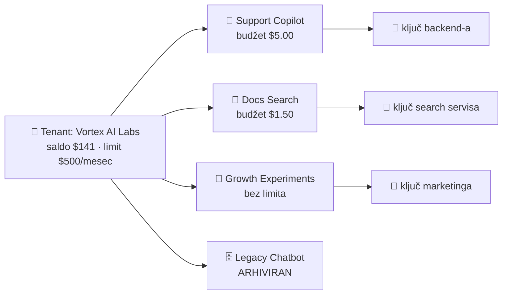
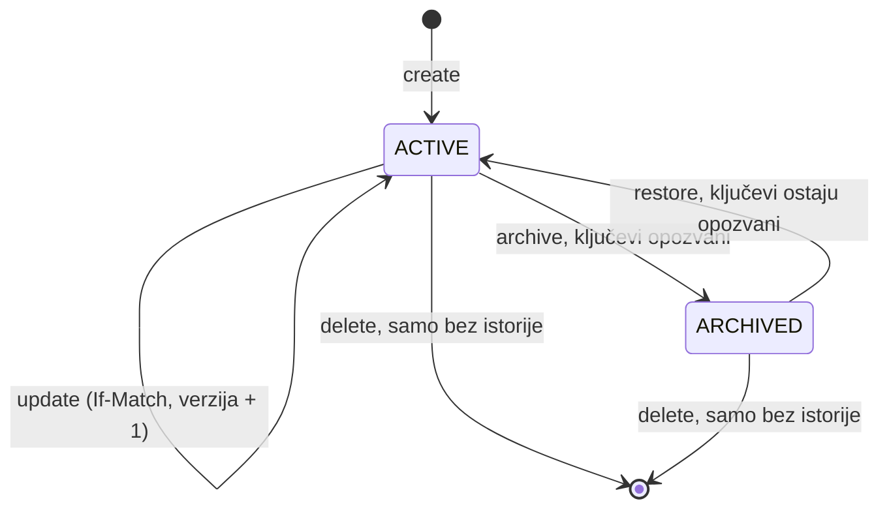

# Projekti (cost centri): CRUD koji čuva novac

> Konzola → **Projects**. Tehnički detalji i ADR-ovi: [SYSTEM_DESIGN.md §4.3 i ADR-010…012](../SYSTEM_DESIGN.md).

## 1. Problem koji rešava

Tenant (firma) ima jedan saldo i jedan mesečni limit. U praksi ista firma ima **više proizvoda i timova**, npr.
"Support Copilot", "Docs Search" i "Growth Experiments". Finansije pitaju:

- *Koliko troši svaki proizvod?*
- *Može li eksperiment da potroši budžet glavnog proizvoda?*

Projekat je **cost centar unutar tenanta**:
- svaki API ključ pripada projektu;
- svaka stavka u ledger-u zna kom projektu je naplaćena;
- projekat može imati **sopstveni mesečni budžet**, koji se proverava *pre* generisanja i jednog tokena.



## 2. Hijerarhijski budžet: tri provere pod jednim lock-om

Svaki zahtev pre streama prolazi kroz tri provere, **sve u istoj transakciji i pod istim `SELECT … FOR UPDATE`
lock-om reda tenanta**:

```
  zahtev (ključ → tenant + projekat)
     │
     ├─ 1. saldo tenanta ≥ hold?                         ne → 402 insufficient-quota
     ├─ 2. mesečni limit tenanta?                         ne → 402 budget-limit-exceeded
     └─ 3. projekat: potrošeno + hold-ovi + novi hold     ne → 402 project-budget-exceeded
            ≤ mesečni budžet projekta?                         (tenant i dalje ima para!)
     ↓
  RESERVE (sa project_id) → stream → SETTLE + RELEASE (nasleđuju project_id)
```

**Zašto je ovo dobar dizajn:**
- **Bez novog zaključavanja.** Lock reda tenanta već serijalizuje sav novac jednog tenanta, pa je i provera projekta
  automatski bezbedna od trke. Test: 20 paralelnih hold-ova od $0,10 na budžet od $1 → **tačno 10 prođe**.
- **Bez drugog "salda".** Potrošnja projekta se računa iz append-only ledger-a (SETTLE ovog meseca + hold-ovi koji su
  još u toku), pa nema brojača koji bi mogao da se raziđe sa stvarnošću.

## 3. CRUD sa pravilima, a ne samo četiri SQL naredbe

| Operacija | HTTP | Pametno pravilo |
|---|---|---|
| **Create** | `POST /api/v1/tenant/projects` → `201` + `Location` + `ETag: "0"` | Ime je jedinstveno među *aktivnim* projektima, bez obzira na velika i mala slova. Proverava se u kodu **i** parcijalnim unique indeksom, pa trka dva taba daje 409, a ne 500. Najviše 25 aktivnih projekata. |
| **Read** | `GET …/projects` (lista + trošak bez projekta) · `GET …/{id}` (30 dana po danima + ključevi) | Svaki projekat odmah vraća poziciju budžeta: potrošeno, hold-ovi u toku, preostalo i iskorišćenost u %. |
| **Update** | `PUT …/{id}` sa **`If-Match: "verzija"`** | Bez zaglavlja: **428**. Ako je neko u drugom tabu sačuvao pre tebe: **412** + trenutna verzija. Nema "izgubljene izmene". |
| | | Budžet se **ne može spustiti ispod već potrošenog** ovog meseca (409), pa invarijanta *potrošnja ≤ budžet* uvek važi. |
| **Archive** | `POST …/{id}/archive` | Ključevi projekta se **opozivaju u istoj transakciji**, pa saobraćaj odmah staje (401). Keš ključeva se čisti tek **posle commit-a**. |
| **Restore** | `POST …/{id}/restore` | Ime mora biti slobodno. Stari ključevi **ostaju opozvani**, jer bezbednost ne sme da se "vrati" slučajno. |
| **Delete** | `DELETE …/{id}` → `204` | Samo za projekat koji **nikad nije imao saobraćaj**. Ako ga ledger pominje, odgovor je **409 "archive it instead"**, jer je ledger append-only i istorija mora da ostane. |
| **Premesti ključ** | `PATCH /api/v1/tenant/api-keys/{id}` `{ "project_id": … }` | Budući zahtevi se naplaćuju novom projektu, a istorija ostaje tamo gde je naplaćena. |



## 4. Bezbednost: ni baza ne dozvoljava tuđi projekat

PostgreSQL proverava foreign key-eve **bez RLS-a**. Kad bi kolona bila samo `project_id → projects(id)`, greška u
kodu bi mogla da veže zahtev tenanta B za projekat tenanta A. Zato je svaka veza **kompozitna**:

```sql
FOREIGN KEY (tenant_id, project_id) REFERENCES projects (tenant_id, id)
```

Takav red baza odbija čak i kad ga upisuje vlasnik tabele, koji zaobilazi RLS. Test to proverava.
Sve ostalo pokriva isti RLS kao za ostale tabele: tuđi projekat je jednostavno **404**.

## 5. Brojevi koji to dokazuju

- **8 novih integracionih testova** nad pravim PostgreSQL-om:
  - CRUD, 409, 412 i 428;
  - arhiviranje opoziva ključeve;
  - brisanje sa istorijom vraća 409;
  - 402 na gateway-u;
  - konkurentnost;
  - izolacija i kompozitni FK.
- Ukupno **106 testova**; coverage je 96,8% linija i 87,4% grana (gate je 85%).
- **Audit nad produkcijom ima 13/13 provera**, od toga 3 nove:
  - RESERVE, SETTLE i RELEASE jednog zahteva idu na isti projekat;
  - mesečna potrošnja ≤ budžet za svaki projekat;
  - arhiviran projekat nema nove hold-ove.

## 6. Scenario za prezentaciju (3 minuta)

1. **Projects** u demo workspace-u: "Docs Search" je na **99% budžeta** (žuta traka, *Near limit*), a "Support
   Copilot" na ~60%. Gornji red pokazuje i trošak koji nije vezan ni za jedan projekat.
2. Klik na **Docs Search** otvara grafikon dnevne potrošnje za 30 dana i ključeve projekta.
3. **New project** "Demo" sa budžetom **$0.005**.
4. **Playground** → *Charge to: Demo* → *Send prompt*. Odgovor je **402 project-budget-exceeded**, iako tenant ima $141.
   Hold za 400 tokena po najskupljem modelu (claude-sonnet, $15/1M) je ~$0,006, što je veće od budžeta, pa se ne
   generiše nijedan token i ne troši se ni cent.
5. **Projects → Edit "Demo"** → budžet $1 → *Save* (`PUT` sa `If-Match`). Isti prompt u Playground-u sada prolazi.
   - Bonus: otvori Edit u dva taba i sačuvaj u oba. Drugi tab dobija *"Someone saved this project in another tab"* (412).
6. **Delete "Demo"** daje **409** *"has billing history … archive it instead"*, jer je projekat sada u ledger-u.
   **Archive** radi, a ključevi projekta su istog trena opozvani.

> Zašto ne "Docs Search" na 99%? Kratki promptovi su jeftini, pa preostalih ~$0,01 propusti još nekoliko zahteva.
> Budžet manji od jednog hold-a daje 402 iz prvog pokušaja, svaki put.
