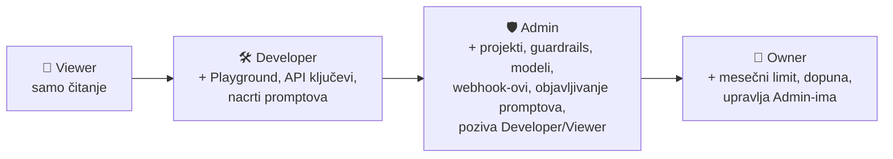
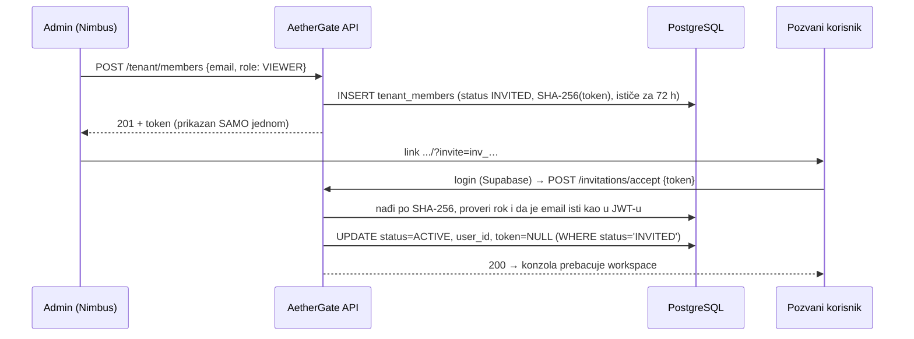
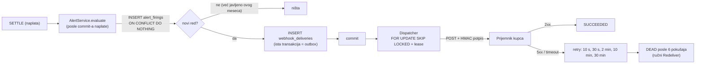
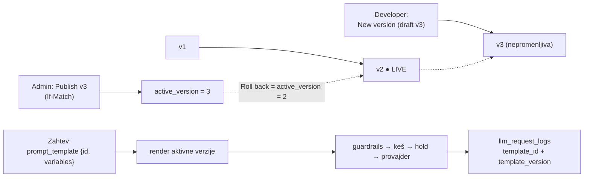

# Tim i uloge, webhook-ovi, politike ključeva, biblioteka promptova

> Tehnički detalji: [SYSTEM_DESIGN.md §4.6–4.9, ADR-015…019](../SYSTEM_DESIGN.md) · Prethodni CRUD:
> [TENANT_CRUD_EXPLAINED.md](TENANT_CRUD_EXPLAINED.md) · Projekti: [PROJECTS_EXPLAINED.md](PROJECTS_EXPLAINED.md)

Ove četiri funkcije imaju svi ozbiljni AI gateway-i (Portkey, LiteLLM, Helicone, Kong AI). Svaka je napravljena po
istom standardu kao ostatak sistema:
- tabele pod **Row-Level Security**;
- pravila koja provera **baza**, a ne samo kod;
- integracioni testovi nad pravim PostgreSQL-om.

| Meni | Šta tenant dobija | "Pametno" pravilo koje vredi pokazati |
|---|---|---|
| **Team** | članovi, pozivnice, uloge, audit log | uloge proverava **API** na svakom zahtevu; niko ne može da dodeli ulogu jednaku ili višu od svoje |
| **Alerts** | budžetska upozorenja + potpisani webhook-ovi | upozorenje stiže **tačno jednom** mesečno, a to garantuje unique indeks |
| **Settings → API keys** | istek, dozvoljeni modeli, IP allow-list, rotacija | rotacija bez prekida rada: stari ključ važi još N sati |
| **Prompts** | templejti sa `{{promenljivama}}` i verzijama | verzije su nepromenljive (trigger), a statistika troška se vodi po verziji |

---

## 1. Tim i uloge (RBAC)

### Uloge



**Kako se proverava:**
- Svaki zahtev konzole prolazi kroz `RoleInterceptor`. On iz JWT-a i header-a `X-Workspace-Id` nalazi
  workspace i ulogu, pa poredi ulogu sa anotacijom `@RequiresRole` na endpoint-u.
- **Bezbedan default:** endpoint bez anotacije traži Viewer za GET, a **Admin za svaki upis**. Novi endpoint je
  zato zatvoren dok neko svesno ne odluči drugačije.
- Sakrivanje dugmadi u UI-ju je samo udobnost. Pravu proveru radi API: Viewer koji pošalje `POST` direktno dobija
  `403 insufficient-role`, sa poljima `required_role` i `your_role`.

### Pozivnica: tok



**Pravila koja sprečavaju eskalaciju privilegija i zaključavanje:**

| Pravilo | Kako je sprovedeno |
|---|---|
| Dodeljuješ samo uloge **ispod svoje** (Owner sve) | `requireCanManage`, 403 |
| Niko ne menja svoju ulogu | 403 |
| Primarni vlasnik se ne može ukloniti | uopšte nije red u `tenant_members` |
| Token pozivnice se čuva samo kao SHA-256, važi jednom i 72 h | unique indeks + `status='INVITED'` u WHERE |
| Pozivnicu može da iskoristi samo nalog sa **pozvanim email-om** | 403 `invitation-email-mismatch` (email je maskiran: `n***@…`) |
| Ponovno slanje daje **novi** token, a stari link prestaje da važi | 410 `invitation-invalid` |
| Uklonjen član gubi pristup **već na sledećem zahtevu** | keš članstva se briše posle commit-a |
| Promena uloge je optimistička | `If-Match` (428 / 412) |
| Demo workspace ne može da poziva ljude | 403 `demo-read-only` |

**Više workspace-ova po korisniku:** jedan nalog može da bude vlasnik svog workspace-a i član tuđih. U header-u konzole
je padajući meni za izbor, a izbor se šalje kao `X-Workspace-Id`. Ako je korisnik u međuvremenu uklonjen, `/me` ga vraća
na podrazumevani workspace (`workspace_fallback: true`) umesto da prijavi grešku.

### Audit log

Svaki upis iz konzole, **uključujući odbijene** (npr. 403), beleži se u `audit_events`: ko, sa kojom ulogom, koja
ruta, koji objekat i sa kojim HTTP statusom. Tabela je **append-only**: trigger odbija UPDATE i DELETE, isto kao kod
ledger-a. Admin vidi log na stranici *Team*.

---

## 2. Budžetska upozorenja i potpisani webhook-ovi

### Zašto "outbox"

Naivan pristup je da se HTTP poziv pošalje odmah posle naplate. Ako transakcija posle toga padne, webhook je već
otišao za nešto što se nije desilo. Ako proces padne pre slanja, webhook se gubi.



**Ključne ideje:**
1. **Tačno jednom mesečno.** Odluku o tome da li je upozorenje već poslato donosi **unique indeks**
   `(rule_id, period)`, ne kod. Kad 20 paralelnih naplata pređe 80 %, sve pokušaju INSERT, a uspe tačno jedan red.
   Samo taj pobednik upisuje webhook. Test proverava da stiže tačno jedan.
2. **Transakcioni outbox.** Isporuka se upisuje u istoj transakciji kao događaj. Ako se transakcija poništi, webhook
   nikad ne postoji; ako se commit-uje, isporuka je trajna i preživljava pad procesa.
3. **Više instanci bez duplog slanja.** `FOR UPDATE SKIP LOCKED` plus "lease" od 2 minuta: dve instance nikad ne šalju
   istu isporuku istovremeno, a ako instanca padne usred slanja, lease istekne i druga ponovi.
4. **At-least-once.** Prijemnik deduplicira po `X-AetherGate-Event-Id`, a ručni *Redeliver* zadržava isti event id.

### Potpis (kao Stripe)

```
X-AetherGate-Signature: t=1764072000,v1=5f2c…(HMAC-SHA256 hex)
potpisuje se:  t + "." + sirovo telo zahteva
```

- Potpisuje se i vreme `t`, pa uhvaćen zahtev ne može da se ponovi kasnije: prijemnik odbija `t` stariji od 5 minuta.
- Poređenje je u konstantnom vremenu (`MessageDigest.isEqual`).
- Tajna (`whsec_…`) se prikazuje samo pri kreiranju i rotaciji. *Rotate secret* odmah poništava staru.

### SSRF zaštita (vredi istaći)

Webhook je zahtev koji **server** šalje na URL koji je izabrao **kupac**. Bez zaštite, tenant bi mogao da natera
gateway da pozove `http://169.254.169.254/` (Oracle Cloud metadata sa kredencijalima instance) ili `localhost:8080`.

| Sloj | Šta odbija |
|---|---|
| Pri čuvanju | sve osim `https://`; korisničko ime i lozinku u URL-u; `localhost`, `*.local`, `*.internal`, imena bez tačke; privatne i link-local IP literale |
| Pri **svakom** slanju | host se ponovo razrešava i **svaka** adresa mora biti javna (zaštita od DNS rebinding-a): 10/8, 172.16/12, 192.168/16, 127/8, 169.254/16, 100.64/10 (CGNAT), fc00::/7, multicast |
| HTTP klijent | **ne prati redirect-e** (3xx bi mogao da vodi na internu adresu); timeout 5 s |

Podržani događaji: `budget.threshold_crossed`, `guardrail.blocked` (sam prompt se **nikad** ne šalje),
`api_key.rotated`, `member.joined`, i `webhook.test` za dugme *Send test*.

---

## 3. Politike API ključeva i rotacija

Na svakom ključu (Settings → API keys → *Policy*):

| Polje | Efekat | Odgovor |
|---|---|---|
| **Expires** | posle tog trenutka ključ ne radi | `401` sa porukom "This API key expired at …" |
| **Allowed models** | ključ sme samo te modele; `auto` rutira **samo** preko njih | `403 model-not-allowed` |
| **IP allow-list** | CIDR opsezi (IPv4 i IPv6) | `403 ip-not-allowed` |
| **RPM / TPM** | limiti po ključu | `429` |

- Izmena je optimistička (`If-Match`), a keširani principal se briše odmah, pa sledeći zahtev već vidi novu politiku.
- **Pametan detalj:** kad ključ sme samo jeftin model, pre-flight hold se računa **samo nad tim modelima**, pa je i
  rezervacija manja. Semantički keš ne vraća odgovor koji je generisao model koji ključ ne sme da koristi.
- **IP iza Caddy-ja:** adresa klijenta stiže kroz `X-Forwarded-For`. Caddy tu vrednost uvek prepisuje (ne veruje
  klijentu), a port 8080 nije javno izložen.

### Rotacija bez prekida rada

```mermaid
gantt
    dateFormat HH:mm
    axisFormat %H:%M
    section Stari ključ
    radi normalno           :done, 09:00, 10:00
    grace period (24 h)     :active, 10:00, 12:00
    401 expired             :crit, 12:00, 13:00
    section Novi ključ
    radi od trenutka rotacije :10:00, 13:00
```



*Rotate* pravi novi ključ sa istim projektom, limitima i ograničenjima (`rotated_from` čuva liniju). Stari ključ važi
još 0 h (odmah opozvan), 1 h, 24 h ili 7 dana, pa servisi kupca mogu da pređu na novi bez ijednog odbijenog zahteva.
Šalje se i webhook `api_key.rotated`.

---

## 4. Biblioteka promptova sa verzijama

Problem: promptovi su zakucani u kodu aplikacija, pa svaka promena traži deploy i niko ne zna koja verzija je jeftinija.



- **Verzije se ne menjaju:** trigger `trg_prompt_versions_immutable` odbija UPDATE. Izmena uvek pravi verziju N+1.
- **Podela odgovornosti:** Developer pravi nacrte, a samo Admin objavljuje ili vraća verziju. Nacrt nikad ne dobija
  produkcijski saobraćaj.
- **Promenljive** `{{customer}}`: ako neka nedostaje, odgovor je 400 sa spiskom svih koje nedostaju. Vrednosti se
  ubacuju **doslovno u jednom prolazu**, pa korisnički unos `{{product}}` ne može da "ubaci" drugu promenljivu
  (zaštita od template injection-a, test to proverava).
- **Guardrails važe i za templejte:** renderovani prompt prolazi isti pipeline.
- **Statistika po verziji:** broj zahteva, prosečan trošak, tokeni ulaz/izlaz, latencija, procenat keš pogodaka. Tako
  se vidi da je v2 ("5 bullet points") jeftinija od v1.
- Templejt koji je služio saobraćaj ne može da se obriše (409), jer ga request log referencira.

Poziv iz bilo kog OpenAI SDK-a (AetherGate ekstenzija):

```json
{ "model": "auto",
  "prompt_template": { "id": "discharge-summary", "variables": { "clinic": "Nimbus", "visit_notes": "…" } } }
```

---

## 5. Scenario za prezentaciju (≈6 minuta)

Login kao **Nimbus Health** (`nimbus.admin@aethergate.dev`, lozinka u `TENANT_LOGINS.md`, van repoa).

1. **Prompts:** otvori `discharge-summary`. Tabela verzija pokazuje da v2 ima manji prosečan trošak i manje izlaznih
   tokena od v1 → *Roll back* na v1 → *Publish* v2. Pomeni da su verzije nepromenljive i da objavljuje samo Admin.
2. **Playground:** *Source* = `Template: discharge-summary`, popuni `clinic` i `visit_notes` → *Send*. Na *Prompts*
   v2 dobija +1 zahtev.
3. **Alerts:** pokaži upozorenja na 50 % i 80 % (seed ih je već okinuo) → *Add endpoint* sa URL-om sa
   [webhook.site](https://webhook.site) → *Send test* → na webhook.site se vidi `X-AetherGate-Signature`.
   Pokušaj sa `https://169.254.169.254/` → **400** (SSRF zaštita).
4. **Settings → API keys → Policy:** dozvoli samo `gpt-4o-mini` i IP `10.0.0.0/8` → poziv iz terminala daje
   **403 ip-not-allowed**. *Rotate* sa 24 h → oba ključa rade.
5. **Team:** *Invite member* `helix.admin@aethergate.dev` kao **Viewer** → kopiraj link → u privatnom prozoru se
   uloguj kao Helix i otvori link → padajući meni u header-u sada nudi i "Nimbus Health · Viewer" → *New project*
   daje **403 insufficient-role** → kao Nimbus admin, u *Audit log* se vidi odbijeni pokušaj (403).
   Na kraju ukloni člana: Helix gubi pristup već na sledećem zahtevu.

Sve korake pokrivaju integracioni testovi (`TeamAndRbacIntegrationTest`, `WebhooksKeysPromptsIntegrationTest`):
pravi PostgreSQL u kontejneru i pravi HTTP prijemnik za webhook-ove, čiji se HMAC potpis proverava.
