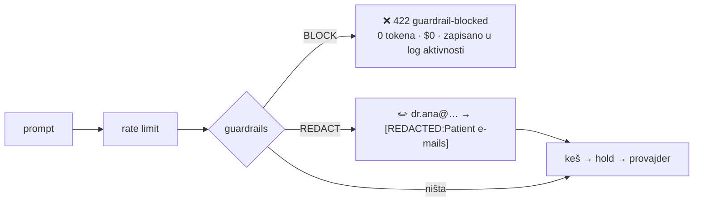

# Šta tenant može sam da upravlja: CRUD operacije u konzoli

> Tehnički detalji: [SYSTEM_DESIGN.md §4.3–4.5, ADR-010…014](../SYSTEM_DESIGN.md) · Projekti posebno:
> [PROJECTS_EXPLAINED.md](PROJECTS_EXPLAINED.md)

## 1. Pregled: pet resursa, svaki sa pravilima koja čuvaju novac ili podatke

| Resurs (meni) | Create | Read | Update | Delete | "Pametno" pravilo |
|---|---|---|---|---|---|
| **Projects** | ✔ | ✔ lista + detalj | ✔ `If-Match` | ✔ samo bez istorije, inače archive | budžet projekta se proverava pre prvog tokena |
| **Guardrails** | ✔ | ✔ + aktivnost | ✔ `If-Match` + uključi/isključi | ✔ istorija ostaje | BLOCK košta $0; REDACT krije podatke od provajdera i keša |
| **Settings → Models** | ✔ dodaj model | ✔ | ✔ promena cene | ✔ | sledeći hold koristi novu cenu; poslednji model se ne briše |
| **Settings → Workspace** | (pri registraciji) | ✔ | ✔ ime i limit | — | limit nikad ispod već potrošenog; demo je samo za čitanje |
| **Settings → API keys** | ✔ (u projektu) | ✔ | ✔ premesti u projekat | ✔ opoziv | ključ se čuva samo kao SHA-256 |

Svi resursi su izolovani **Row-Level Security-jem u PostgreSQL-u**. Tuđi resurs je uvek **404**, a nove tabele su u
automatskoj proveri izolacije (audit 13/13).

---

## 2. Guardrails: pravila za promptove

**Problem:** zaposleni zalepi u prompt email pacijenta, broj kartice ili lozinku, i to ode trećoj strani (OpenAI,
Anthropic), u keš i u logove. **Rešenje:** tenant sam definiše pravila, a gateway ih primenjuje **pre** keša, pre
naplate i pre provajdera.

| Tip pravila | Šta prepoznaje | Primer |
|---|---|---|
| **E-mail adrese** | ugrađeni detektor | `dr.ana@nimbus-health.example` |
| **Platne kartice** | 13–19 cifara, prefiks kartične mreže (2–6) **i** Luhn kontrolna suma | `4111 1111 1111 1111` ✔ · `1234 5678 9012 3456` ✘ |
| **Ključne reči** | cele reči, bez obzira na velika i mala slova | `Project Atlas, prototype X9` |
| **Regex** | Java regularni izraz (do 500 znakova) | `\bMRN-\d{6}\b` (broj kartona pacijenta) |

**Akcije:**
- **Block:** zahtev se odbija sa 422 pre bilo kakve naplate.
- **Redact:** pogodak se zamenjuje sa `[REDACTED:ime pravila]` i zahtev nastavlja. Provajder, semantički keš i
  logovi **nikad ne vide original**, a test to proverava direktno u keš tabeli.

**Inženjerski detalji koje vredi pomenuti:**

1. **ReDoS zaštita.** Regex kao `(a+)+$` na dugom unosu može da "zamrzne" server (katastrofalni backtracking). Java
   regex nema timeout, pa motor čita prompt kroz `CharSequence` koji na svakih 1.024 čitanja proverava rok od 25 ms.
   Ako se rok probije, zahtev se **blokira (fail closed)**, nikad propušta. U testu se napad prekida za manje od pola sekunde.
2. **Pravila se kompajliraju pri čuvanju**, ne pri zahtevu. Neispravan regex daje 400 sa razlogom
   (*"Invalid regular expression: Unclosed group"*), a regex koji odgovara praznom stringu se odbija.
3. **Keš pravila i događaj posle commit-a.** Kompajlirana pravila se keširaju po tenantu. Svaka izmena objavljuje
   događaj koji briše keš **tek posle commit-a**, pa isključeno pravilo prestaje da važi već od sledećeg zahteva (test).
4. **Priča iz razvoja: lažni pozitiv.** Tokom testiranja u browser-u, prompt sa 13-cifrenim timestamp-om
   (`Date.now()`) je blokiran kao "kartica". Razlog: ~10% nasumičnih 13-cifrenih brojeva prolazi Luhn proveru. Rešenje
   je dodatna provera prefiksa kartične mreže (prave kartice počinju sa 2–6, timestamp-ovi sa 1), uz regresioni test.

---

## 3. Modeli i cene (Settings → LLM provider fallback chain)

- **Add model:** provajder (OpenAI, Anthropic ili Gemini), naziv modela, cena ulaza i izlaza po 1M tokena. Model ide na kraj lanca.
- **Edit (✎):** nova cena važi od **sledećeg** zahteva, a hold-ovi koji su već uzeti zadržavaju staru cenu. Hold se
  računa po najskupljem uključenom modelu, pa skuplji model odmah povećava pre-flight rezervaciju (test: izlaz
  $1000/1M → hold tačno $0,06 za 60 tokena).
- **Remove (🗑):** prioriteti se ponovo numerišu bez rupa, a poslednji uključeni model se ne može obrisati (409).
- Duplikat (isti provajder i model) daje 409; najviše 6 modela u lancu.

## 4. Workspace (Settings → Workspace)

- Ime i **mesečni hard limit** tenanta. Header konzole odmah prikazuje novo ime.
- Limit ispod potrošnje ovog meseca → **409** *"below this month's committed spend"*.
- **Zašto ovde nema `If-Match`:** verzija reda tenanta se menja sa svakom rezervacijom, pa bi ETag zastareo za
  nekoliko milisekundi. Umesto toga, izmena uzima **isti row lock kao naplata** (ADR-014).
- **Demo workspace** (dugme *Continue with Demo Workspace*) je za ovo samo za čitanje (403), jer ga vide svi posetioci.

---

## 5. Scenario za prezentaciju (≈4 minuta, prijava kao Nimbus Health)

Login: `nimbus.admin@aethergate.dev`. Lozinka je u `TENANT_LOGINS.md`, van repoa.

1. **Guardrails** → *Try it* → *Test prompt* (podrazumevani tekst sadrži karticu). Rezultat: **Blocked by "Payment cards"**.
2. U *Try it* upiši: `Email lab results for MRN-482913 to dr.ana@nimbus-health.example today` → **Allowed with 2
   redaction(s)**, a u odgovoru su istaknuti `[REDACTED:Medical record numbers]` i `[REDACTED:Patient e-mails]`.
3. **New rule:** *Codename Orion*, tip *Keywords*, `Project Orion`, akcija *Block (422)*.
4. **Playground** → `Draft the launch plan for Project Orion` → crveni banner **422 · Blocked by guardrail 'Codename Orion'**.
   Pomeni da nije potrošen ni cent.
5. Playground → `Summarise the visit for patient jane.roe@mail.example, MRN-100200` → odgovor stiže, a u *Live
   telemetry* piše **Guardrail redactions: 2 masked**.
6. **Guardrails** → u *Recent activity* su oba događaja → obriši *Codename Orion* (istorija ostaje).
7. **Settings → Add model:** Anthropic `claude-haiku-4-5`, $1 / $5 → ✎ promeni izlaz na $4.50 → 🗑 ukloni.
8. **Settings → Workspace:** preimenuj u "Nimbus Health Clinics" (header se menja odmah) → limit `0.01` → **409**
   → vrati "Nimbus Health" i 750.

Sve korake sam proverio automatizovanim browser testom nad produkcijom, i to dva puta zaredom.
